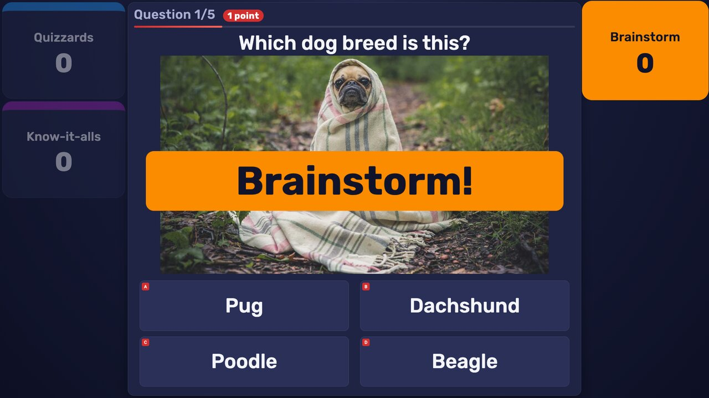
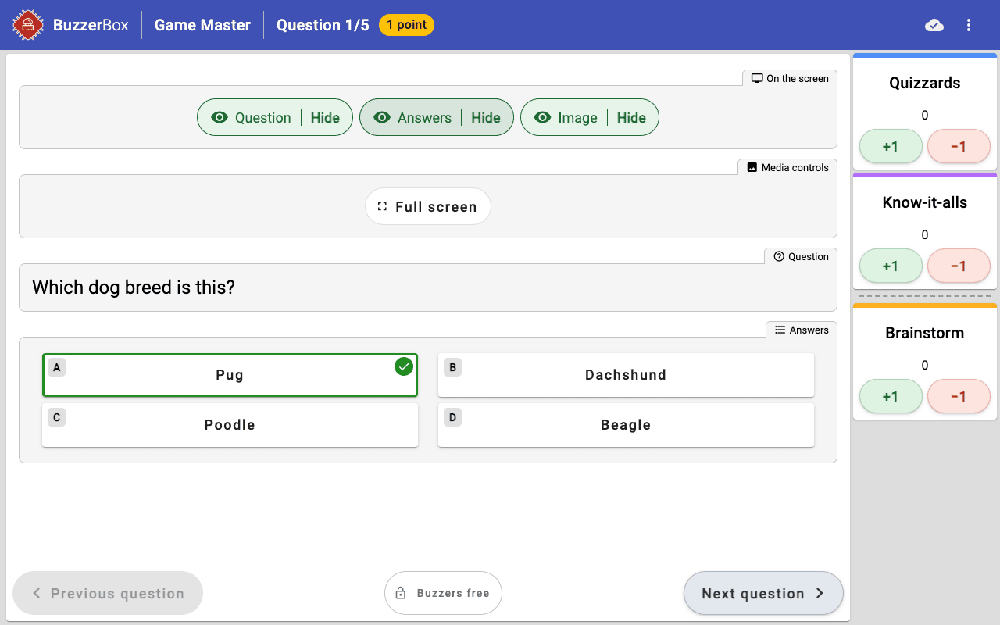
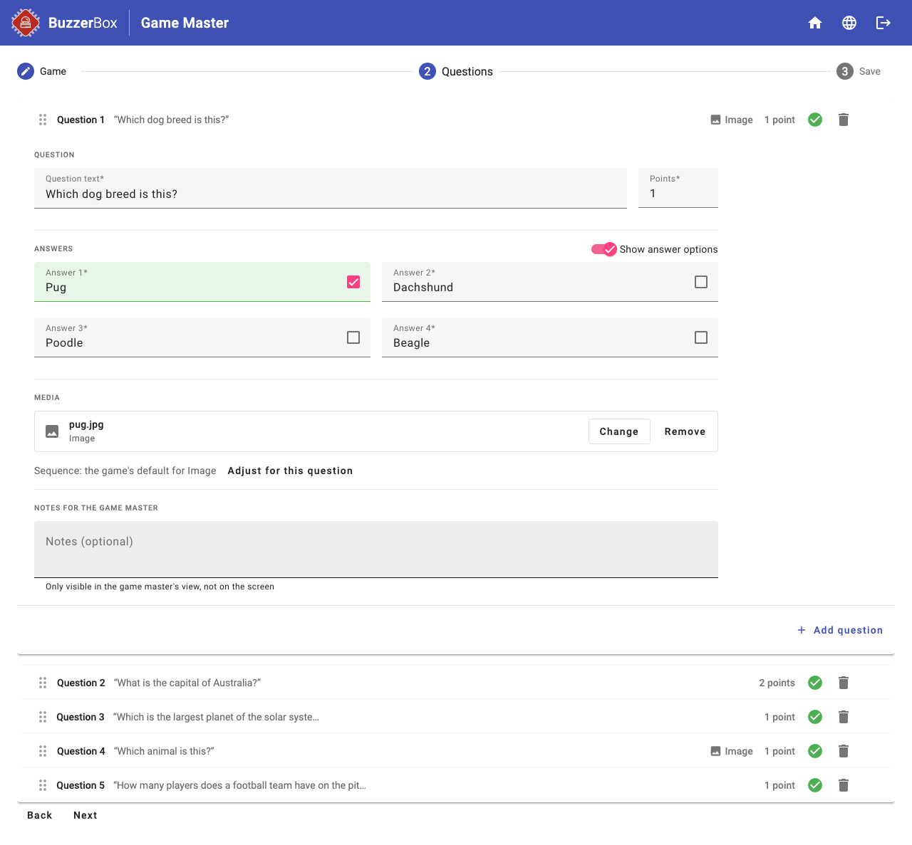
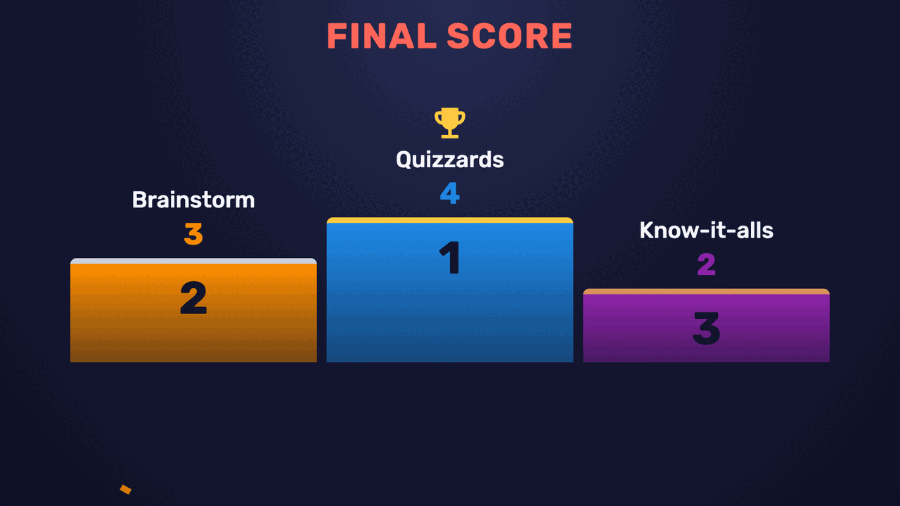

# BuzzerBox

The web app and the wireless buzzers of the **BuzzerBox**, a quiz-show buzzer system: a small box (a Raspberry Pi 4 or Compute Module 4) that
teams plug their buzzers into, with a TV that shows the questions and scores, and a phone, tablet or notebook that
runs the game.

The box opens its own WiFi and needs no internet. The person hosting joins that WiFi, opens the *game master* page in
a browser, and runs the game from there. The TV on the box's HDMI port shows the *screen*. The first team to press its
buzzer locks out the others, and the game master grades the answer.

**Website:** [buzzerbox.github.io](https://buzzerbox.github.io/)

<table>
  <tr>
    <td width="50%"></td>
    <td width="50%"></td>
  </tr>
  <tr>
    <td align="center">The screen on the TV: a team buzzed first</td>
    <td align="center">The game master runs the game from a phone, tablet or notebook</td>
  </tr>
  <tr>
    <td width="50%"></td>
    <td width="50%"></td>
  </tr>
  <tr>
    <td align="center">Quizzes are made in the browser, with images, videos and audio</td>
    <td align="center">The final score</td>
  </tr>
</table>

## Documentation

**For hosts** (people who run a quiz with a BuzzerBox): start with the [user guide](docs/user/README.md).

| | |
|---|---|
| [Quick start](docs/user/quick-start.md) | Set up the box and start a game, on one page |
| [Hosting a game](docs/user/hosting-a-game.md) | Teams, buzzers, grading, media, pausing and ending |
| [Creating games](docs/user/creating-games.md) | The editor, media, moving games between boxes |
| [Wireless buzzers](docs/user/wireless-buzzers.md) | Adopting them, case colors, batteries |
| [Box settings and updates](docs/user/box-settings-and-updates.md) | WiFi name and password, installing updates |
| [Troubleshooting](docs/user/troubleshooting.md) | No picture, no connection, a buzzer that doesn't react |

**For developers and people who build or maintain boxes:**

| | |
|---|---|
| [Development setup](docs/development.md) | Running the server and the client on your computer, simulating buzzers, tests |
| [Architecture](docs/architecture.md) | Packets, game states, buzzer input, storage, media, themes, languages |
| [Configuration reference](docs/configuration.md) | Every key of `config.json` |
| [Box settings reference](docs/box-settings.md) | Every key of `buzzerbox.txt` |
| [Game file format](docs/game-file-format.md) | Versions, states, bundles and archives |
| [Operations](docs/operations.md) | Releases, update bundles and signing, SSH, logs, the test host |
| [Provisioning](provisioning/README.md) | Building and flashing the image of a box |

## The parts

| Part | What it is |
|---|---|
| [`server/`](server/README.md) | The game server (Node.js, Express, `ws`). It holds the game state and is the only source of truth for it. |
| [`client/`](client/README.md) | The Angular app that is both the game master and the screen. |
| `shared/` | Enums, packet interfaces and helpers that the server and the client both import. It has no build of its own. |
| `config.json` | The configuration that the server and the client both build in, see the [reference](docs/configuration.md). |
| [`provisioning/`](provisioning/README.md) | The Ansible playbook and the image build that turn a Raspberry Pi into a BuzzerBox. |
| `install/` | The update helper, its hooks and the public key that updates are checked with. `install.sh` is the old installer for Raspbian Buster and is only kept for boxes from before the image. |
| `scripts/` | Building the update bundle, and helpers for development. |
| `deploy/test/` | The test environment that runs the latest `main` in Docker. |
| [`hardware/`](hardware/README.md) | The 3D-printed case of the BuzzerBox Compact and the base of its wireless buzzers (Fusion, STEP, 3MF and STL). |
| [`firmware/wireless-buzzer/`](firmware/wireless-buzzer/README.md) | The firmware of the wireless buzzers (ESP32 Feather V2 or Feather ESP32-S3, PlatformIO). Its README documents the UDP and the USB protocol from the buzzer's side; change both sides together. |

## Trying it out

```sh
cp config.dev.json.example config.dev.json
(cd server && npm install && npm run transpile && npm start -- --dev=1)
(cd client && npm install && npm start)          # in a second terminal
```

Then open http://localhost:4200. The number keys are the buzzers on a screen, and `Q` releases them. The
[development setup](docs/development.md) has the details.
