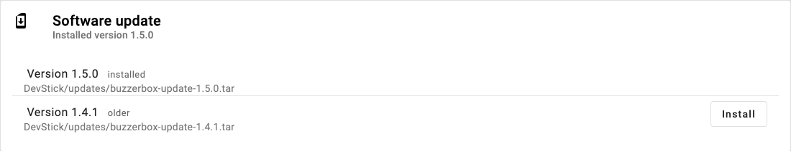

# Box settings and updates

## The box's settings

Each BuzzerBox has a few settings of its own: the name and password of its WiFi, its address, and whether it has
wired buzzers. They are in the file **`buzzerbox.txt`** on the box's memory card, which any computer can read.

**Give your box its own WiFi password.** Every box starts with the same one, which is public.

To change them:

1. Switch the box off and take out its **SD card**. (A box with a Compute Module has no card; ask whoever built it.)
2. Put the card into a computer. It shows up as a drive called **`bootfs`**.
3. Open `buzzerbox.txt` with a plain text editor (Notepad on Windows, TextEdit on a Mac in plain text mode) and change
   the lines you need:

   ```
   WIFI_SSID=BuzzerBoxNetwork
   WIFI_PASSPHRASE=12TheBuzzerBox_IncredibleNetwork34
   ```

   | Line | What it is | Allowed |
   |---|---|---|
   | `WIFI_SSID` | The name of the box's WiFi | up to 32 characters |
   | `WIFI_PASSPHRASE` | Its password | 8 to 63 characters |
   | `WIFI_COUNTRY_CODE` | The country the box is used in, e.g. `DE`, `AT`, `CH`, `GB`, `US` | two letters |
   | `WIFI_CHANNEL` | The WiFi channel; try another one if the WiFi is unreliable where many other WiFis are | 1 to 13 |
   | `ANALOG_BUZZERS` | `no` for a box without ports for wired buzzers | `yes` or `no` |
   | `SERVER_HOSTNAMES` | The names devices can open the box under | names separated by spaces |

   Keep the format `NAME=value`, without spaces around `=` and without quotes. The other lines are for technicians, see
   the [box settings reference](../box-settings.md).
4. Save the file, eject the card properly, put it back into the box and switch the box on.

A value that isn't allowed is ignored, and the box uses its default for it, so a typo never makes the box unusable.

**After changing the WiFi name or password:**

- Join the new WiFi on your devices.
- [Adopt the wireless buzzers again](wireless-buzzers.md#adopting-a-buzzer), since they keep the WiFi they were given.
- The waiting screen and the first page keep showing the name `BuzzerBoxNetwork` and the address `buzzer.box`; tell your
  guests the new name yourself.

## Installing an update

Updates for the BuzzerBox come as a file `buzzerbox-update-<version>.tar` and are installed from a USB stick. You get
them from the [releases on GitHub](https://github.com/BuzzerBox/BuzzUI/releases) (under *Assets*), or from whoever
looks after your box.

1. On a computer, create a folder named **`updates`** at the top level of a USB stick and put the file into it:
   `updates/buzzerbox-update-1.6.0.tar`. Files anywhere else on the stick are not found.
2. Plug the stick into the BuzzerBox, open the game master and go to its **home page**. No game may be running: pause
   or end it first.
3. The card **Software update** shows the installed version and the updates on the stick. Tap **Install**
   (*Installieren*) next to the newer one.

   

4. Wait. The box installs it and restarts its software, which takes about a minute. Don't pull out the stick and don't
   switch the box off meanwhile. The screens reload by themselves, and the game master offers to **Reload**.

If the new version doesn't start, the box goes back to the previous one by itself, and the card tells you so. Your
games and savegames are kept through an update.

**A warning about a missing signature.** Updates from the BuzzerBox's developers are signed. If the card warns that an
update has no valid signature, it can't be checked where the file comes from. An update has full control over the box,
so only install such an update if you know exactly where it comes from, for example from a developer who built it for
you.
