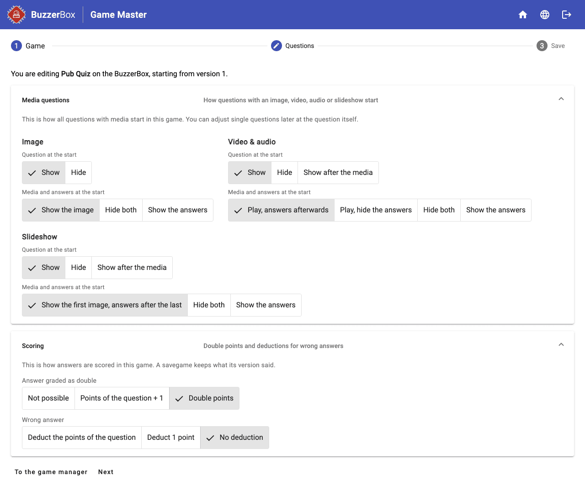
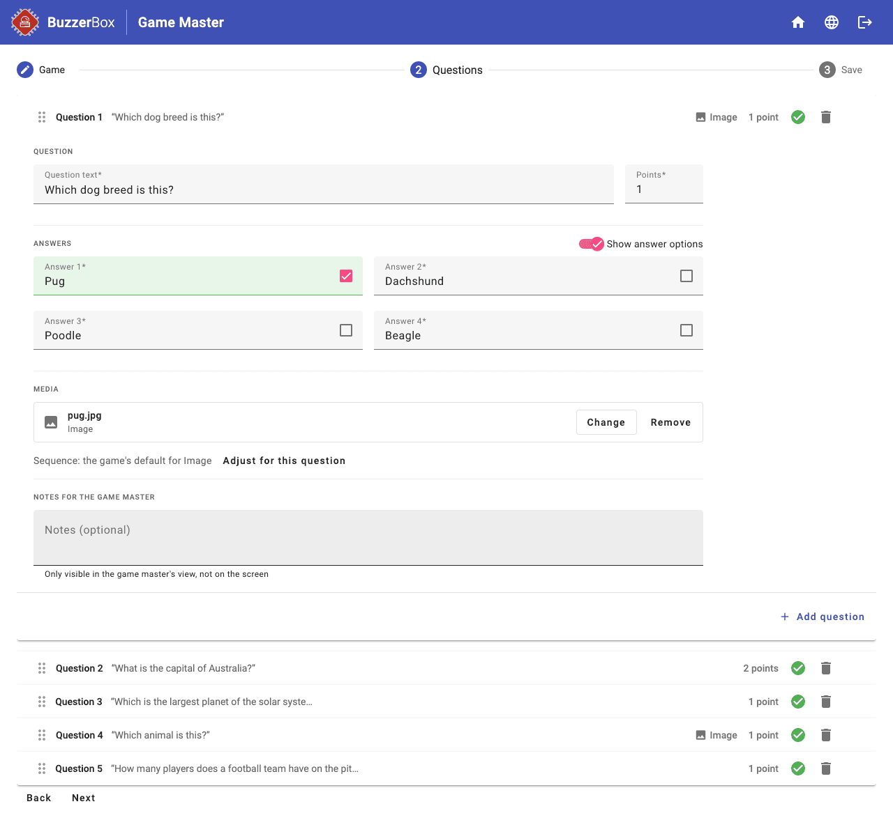
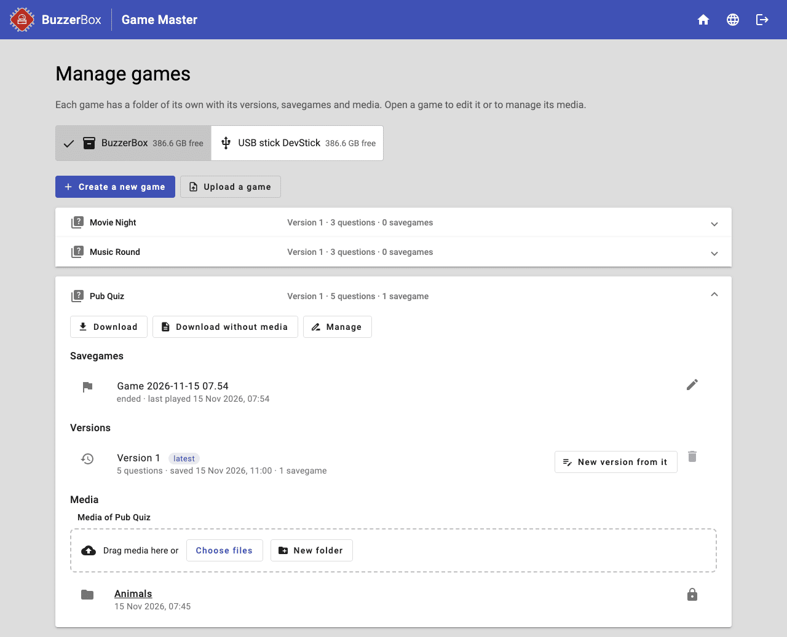

# Creating games

Games are made on the game master's device, in **Manage games** (*Spiele verwalten*) on the home page. A laptop or
tablet is the most comfortable for it, but a phone works too. You need the BuzzerBox for it, since the games are stored
on it or on a USB stick plugged into it.

## Where games are stored

At the top of *Manage games*, choose the **storage location**: the **BuzzerBox** itself, or a **USB stick** plugged into
it. A game keeps everything in one folder there: its questions, its savegames and its media. That is how a whole game
can be moved or copied in one go.

A game has **versions**. Saving it in the editor makes a new version, and a savegame always keeps playing the version
it was started with. So you can change a game while a savegame of it is half played, and the savegame isn't affected.

## The editor

**Create a new game** (*Neues Spiel erstellen*) opens the editor. To change a game, open it in *Manage games* and choose
**New version from it** (*Neue Version daraus*) on a version (or **Create questions**, if it has none yet).

The editor has three steps:

### 1. Game

The name of the game and where it is stored, and two settings for the whole game:

- **Media questions** (*Medienfragen*): how questions with an image, video, audio or slideshow start, for each kind of
  media. For example: play the video first, and show the answers after it. Single questions can do it differently.
- **Scoring** (*Wertung*): what an answer graded as **double** is worth (not possible, the points + 1, or double points),
  and what a **wrong answer** costs (the question's points, 1 point, or nothing). A new game has no double grade and no
  deduction.



### 2. Questions

Each question has:

| Field | What it is |
|---|---|
| **Question text** | What the screen shows. |
| **Points** | What a correct answer is worth, a whole number from 1. |
| **Show answer options** | With options, you fill in all four answers and tick the correct ones (at least one); the screen shows them, marked A to D in the Studio and Daylight looks. Without, the teams answer freely and you grade what they say. |
| **Media** | An image, video or audio file, or a folder of images as a slideshow, see below. |
| **Sequence** | Whether the question and its answers are shown at the start, hidden, or only after the media. By default the game's setting; *Adjust for this question* gives the question its own. |
| **Notes for the game master** | Only you see them on the play page, like presenter notes: the source, a hint, the full answer. |

**Add question** adds one at the end. Drag a question by its handle to move it, and delete it with the bin (*Undo*
brings it back). A question marked *Not complete yet* still lacks its text, an answer or a correct answer, and the game can't be saved until it is complete.



### 3. Save

**Save game** (*Spiel speichern*) saves a new version. If nothing changed, the game stays at its version. **Play
version …** then starts it right away.

## Media

### Adding media to a game

Each game has its own media. In the editor's *Media* field of a question, or under *Media* of the game in *Manage
games*:

- **Upload media** (*Medien hochladen*): drag files onto the page or choose them on your device. They are uploaded to
  the BuzzerBox, which can take a while for large videos over WiFi.
- **Use from the USB stick** (*Vom USB-Stick übernehmen*): copies files or whole folders from a USB stick plugged into the
  box. That is much faster for large files: put them on a stick on your computer, plug it into the box, and copy them
  into the game.
- **New folder** keeps the media of a game tidy. A folder of images can be shown as a **slideshow**: choose the folder
  instead of a file, and its images (at least two) are shown one after the other, in the order of their names: number
  them like `01.jpg`, `02.jpg`, or `1.jpg` … `10.jpg`, which also sorts right.

Uploading a file that the folder already has asks whether to replace it; every question that shows it shows the new one
then. A file that a version of the game shows can't be renamed, moved or deleted, since versions never change.

### Which files work

| Kind | Files |
|---|---|
| Images | `.png`, `.jpg`, `.jpeg`, `.gif`, `.bmp`, `.webp`, `.avif` |
| Video | `.mp4`, `.m4v`, `.webm` |
| Audio | `.mp3`, `.wav`, `.ogg`, `.m4a` |

File names must not contain `\ / : * ? " < > | # %`, since USB sticks don't allow them.

**Videos.** Whether a video plays smoothly depends on what is inside the file, not on its extension. The BuzzerBox
plays **H.264 video with AAC audio in an `.mp4` file, up to 1080p and 30 frames per second** smoothly. `.webm` videos
only play smoothly up to 720p. Videos in **HEVC/H.265** (what iPhones record), AV1 or 4K usually don't play at all or
stutter.

To convert a video, use [HandBrake](https://handbrake.fr/) (preset *Fast 1080p30*) or, on the command line,
[ffmpeg](https://ffmpeg.org/):

```sh
ffmpeg -i input.mov -c:v libx264 -profile:v high -level 4.1 -pix_fmt yuv420p \
  -vf "scale='min(1920,iw)':-2" -c:a aac -b:a 160k -movflags +faststart output.mp4
```

This makes videos wider than 1920 pixels 1080p and keeps smaller ones as they are. **Always try a video on the
BuzzerBox before the game**, on the TV it will be shown on.

## Managing games

Open a game in *Manage games* to see:


- **Versions**, the newest first. *New version from it* opens the editor with its questions; a version without
  savegames can be deleted. A version whose media are missing is marked.
- **Savegames**: each time the game was played, with how far it got. They can be renamed or deleted.
- **Media**: the game's media folder.
- **Manage** (*Verwalten*): rename the game, **move or copy** it with everything in it to another storage location (from
  the box to a USB stick and back), or delete it.

Nothing of a game can be changed while it is being played.



## Moving games between boxes

There are three ways to bring a game to another BuzzerBox:

1. **On a USB stick.** In *Manage games*, *Manage* the game and copy (or move) it to the stick. Plug the stick into the
   other box: the game is there, under the stick's storage location, and can be played from the stick or copied onto
   the box.
2. **Through your device.** **Download** (*Herunterladen*) saves the whole game with its versions, savegames and media
   as one file (`<game>.buzzerbox.tar.gz`). On the other box, **Upload a game** (*Spiel hochladen*) in *Manage games*
   imports it. This also makes a backup of a game.
3. **Only the questions.** **Download without media** (*Ohne Medien herunterladen*) saves the latest version's questions
   as a small `.json` file, for example to send by email. Importing it on another box makes a new game whose media are
   missing until you upload files with the same names, or plug in a stick with them before importing.

*Upload a game* also takes the savegames that older versions of the BuzzerBox downloaded. Their media are copied into
the new game if the USB stick with them is plugged in.
