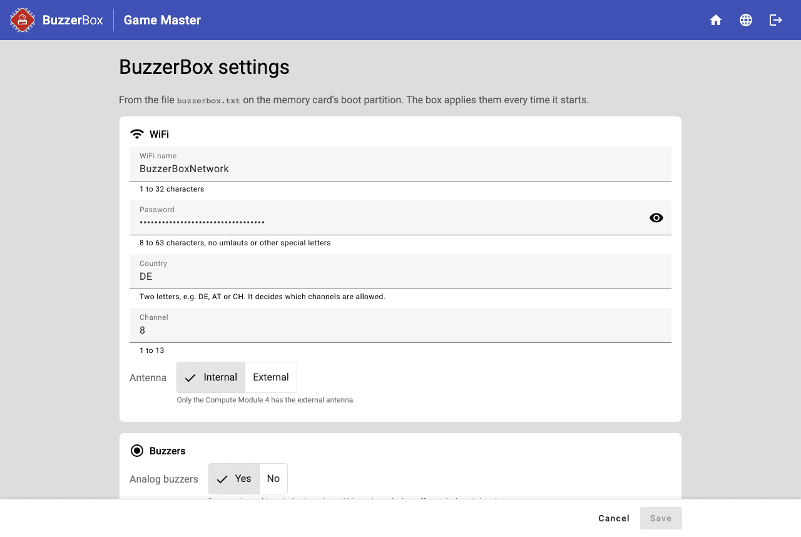
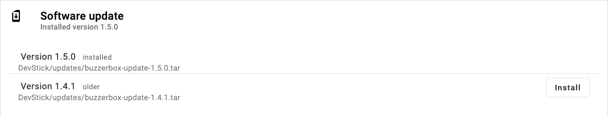

# Box-Einstellungen und Updates

## Die Einstellungen der Box

Jede BuzzerBox hat ein paar eigene Einstellungen: Name und Passwort ihres WLANs, ihre Adresse, ob sie kabelgebundene
Buzzer hat, und die Auflösung des Fernsehers. Sie stehen in der Datei **`buzzerbox.txt`** auf der Speicherkarte der
Box, die jeder Computer lesen kann.

**Gib deiner Box ein eigenes WLAN-Passwort.** Jede Box startet mit demselben, und das ist öffentlich.

### In der Spielleitung

Das Zahnrad oben auf der Startseite der Spielleitung öffnet die Seite **Einstellungen der BuzzerBox**. Sie zeigt die
Einstellungen, die Hardware der Box (Modell, Arbeitsspeicher, Speicherplatz, Temperatur, Softwareversion) und wer sich
über SSH anmelden darf. Sie ist nur da, solange kein Spiel eingerichtet ist.

Standardmäßig zeigt die Seite die Einstellungen nur an. Damit du sie dort ändern kannst, muss die Datei das einmal
erlauben: Füge die Zeile `EDIT_IN_MASTER=true` in `buzzerbox.txt` auf der Speicherkarte hinzu (siehe unten). Wer die
Karte herausnehmen kann, entscheidet, sodass Gäste im WLAN die Box nicht verändern können. Dann:

1. Klicke auf **Bearbeiten**. Jedes Feld sagt, was es erwartet, und die Seite prüft es beim Tippen.

   
2. Ändere, was du brauchst, und klicke unten auf **Speichern**. Verlässt du die Seite mit ungespeicherten Änderungen,
   fragt sie vorher nach.
3. Die Einstellungen gelten ab dem nächsten Start der Box, deshalb bietet die Seite **Jetzt neu starten** an. Hast du
   das WLAN oder die Adresse geändert, sagt sie dir, mit welchem WLAN du dich danach verbinden und was du öffnen musst.

Speichern und Neustarten gehen nicht, solange ein Spiel eingerichtet ist.

### Auf der Speicherkarte

Ohne `EDIT_IN_MASTER=true`, oder um genau diese Zeile zu ändern:

1. Schalte die Box aus und nimm ihre **SD-Karte** heraus. (Eine Box mit Compute Module hat keine Karte; frag, wer sie
   gebaut hat.)
2. Steck die Karte in einen Computer. Sie erscheint als Laufwerk namens **`bootfs`**.
3. Öffne `buzzerbox.txt` mit einem einfachen Texteditor (Editor unter Windows, TextEdit auf dem Mac im
   Reintext-Modus) und ändere die Zeilen, die du brauchst:

   ```
   WIFI_SSID=BuzzerBoxNetwork
   WIFI_PASSPHRASE=12TheBuzzerBox_IncredibleNetwork34
   ```

   | Zeile | Was sie ist | Erlaubt |
   |---|---|---|
   | `WIFI_SSID` | Der Name des WLANs der Box | bis zu 32 Zeichen |
   | `WIFI_PASSPHRASE` | Sein Passwort | 8 bis 63 Zeichen |
   | `WIFI_COUNTRY_CODE` | Das Land, in dem die Box benutzt wird, z. B. `DE`, `AT`, `CH`, `GB`, `US` | zwei Buchstaben |
   | `WIFI_CHANNEL` | Der WLAN-Kanal; probier einen anderen, wenn das WLAN dort unzuverlässig ist, wo viele andere WLANs sind | 1 bis 13 |
   | `ANALOG_BUZZERS` | `no` für eine Box ohne Buchsen für kabelgebundene Buzzer | `yes` oder `no` |
   | `SERVER_HOSTNAMES` | Die Namen, unter denen Geräte die Box öffnen können | Namen, durch Leerzeichen getrennt |
   | `SCREEN_MODE` | Die Auflösung des Fernsehers, z. B. `1920x1080@60`; `auto` lässt den Fernseher wählen | siehe die Referenz |
   | `EDIT_IN_MASTER` | `true` lässt die Spielleitung die Einstellungen ändern | `true` oder `false` |

   Behalte das Format `NAME=wert` bei, ohne Leerzeichen um das `=` und ohne Anführungszeichen. Die übrigen Zeilen sind
   für Techniker, siehe die [Referenz der Box-Einstellungen](../../box-settings.md) (auf Englisch).
4. Speichere die Datei, wirf die Karte ordentlich aus, steck sie wieder in die Box und schalte die Box ein.

Ein Wert, der nicht erlaubt ist, wird ignoriert, und die Box nimmt dafür ihren Standard; ein Tippfehler macht die Box
also nie unbrauchbar.

**Nachdem du WLAN-Name oder Passwort geändert hast:**

- Verbinde deine Geräte mit dem neuen WLAN.
- [Übernimm die Funkbuzzer erneut](wireless-buzzers.md#einen-buzzer-übernehmen), denn sie behalten das WLAN, das sie
  bekommen haben.
- Der Warte-Bildschirm und die erste Seite zeigen weiter den Namen `BuzzerBoxNetwork` und die Adresse `buzzer.box`;
  sag deinen Gästen den neuen Namen selbst.

## Ein Update installieren

Updates für die BuzzerBox kommen als Datei `buzzerbox-update-<version>.tar` und werden von einem USB-Stick installiert.
Du bekommst sie bei den [Releases auf GitHub](https://github.com/BuzzerBox/BuzzUI/releases) (unter *Assets*) oder von
der Person, die sich um deine Box kümmert.

1. Lege am Computer ganz oben auf einem USB-Stick einen Ordner namens **`updates`** an und leg die Datei hinein:
   `updates/buzzerbox-update-1.6.0.tar`. Dateien an anderen Stellen des Sticks werden nicht gefunden.
2. Steck den Stick in die BuzzerBox, öffne die Spielleitung und geh auf ihre **Startseite**. Es darf kein Spiel laufen:
   Pausiere oder beende es vorher.
3. Die Karte **Software-Update** zeigt die installierte Version und die Updates auf dem Stick. Tippe neben dem neueren
   auf **Installieren**.

   

4. Warte. Die Box installiert es und startet ihre Software neu, was etwa eine Minute dauert. Zieh in der Zeit den Stick
   nicht ab und schalte die Box nicht aus. Die Anzeigen laden von selbst neu, und die Spielleitung bietet **Neu laden**
   an.

Startet die neue Version nicht, kehrt die Box von selbst zur vorherigen zurück, und die Karte sagt dir das. Deine Spiele
und Spielstände bleiben bei einem Update erhalten.

**Eine Warnung wegen fehlender Signatur.** Updates von den Entwicklern der BuzzerBox sind signiert. Warnt die Karte,
dass ein Update keine gültige Signatur hat, lässt sich nicht prüfen, woher die Datei stammt. Ein Update hat die volle
Kontrolle über die Box, installiere so ein Update also nur, wenn du genau weißt, woher es kommt, zum Beispiel von einem
Entwickler, der es für dich gebaut hat.
