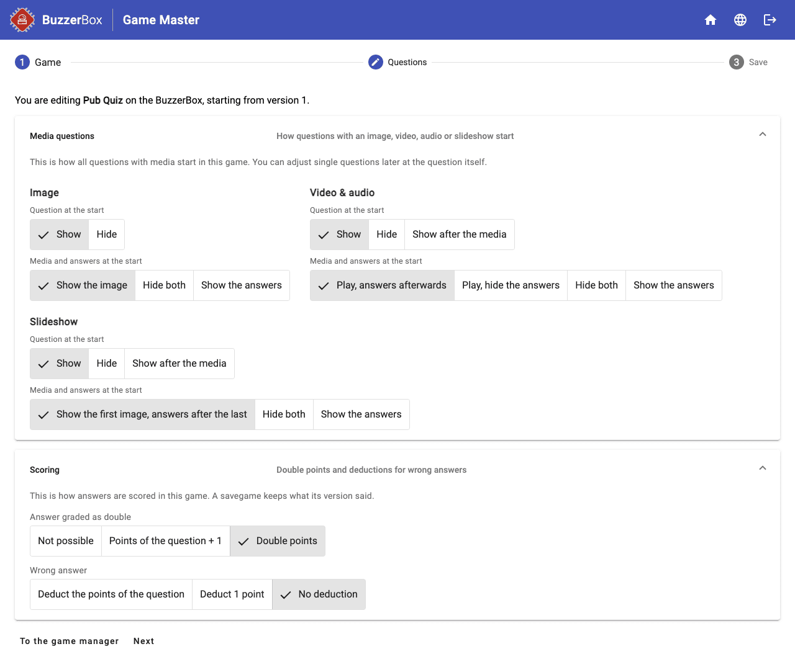
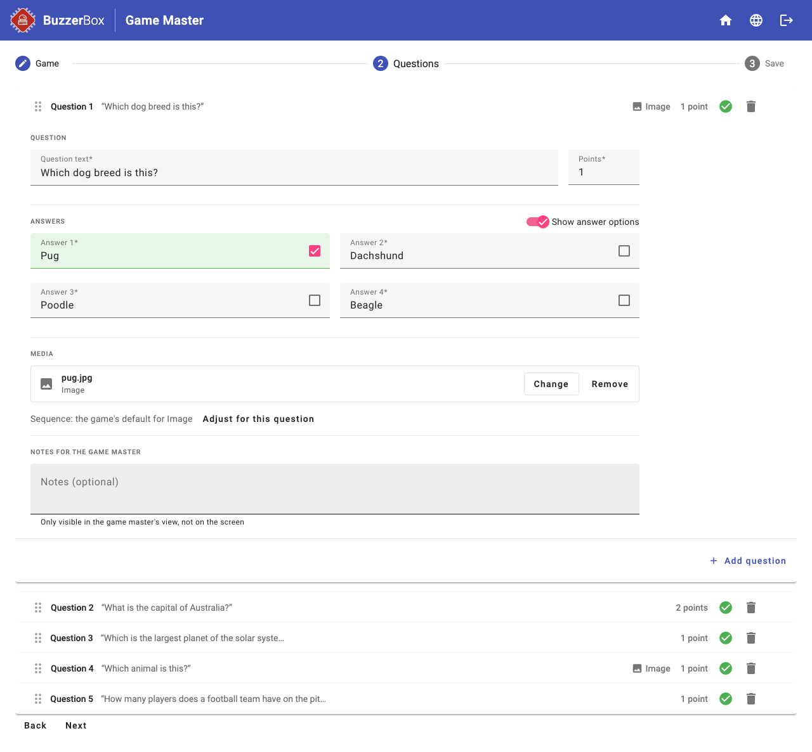
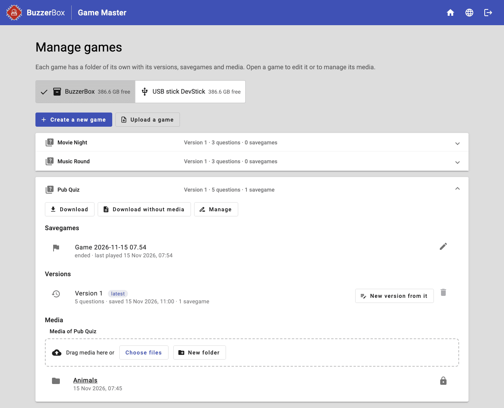

# Spiele erstellen

Spiele entstehen auf dem Gerät der Spielleitung, unter **Spiele verwalten** auf der Startseite. Am bequemsten geht das
mit einem Laptop oder Tablet, aber ein Handy funktioniert auch. Du brauchst dafür die BuzzerBox, weil die Spiele auf
ihr oder auf einem eingesteckten USB-Stick gespeichert werden.

## Wo Spiele gespeichert werden

Wähle oben in *Spiele verwalten* den **Speicherort**: die **BuzzerBox** selbst oder einen eingesteckten **USB-Stick**.
Ein Spiel hat dort alles in einem Ordner: seine Fragen, seine Spielstände und seine Medien. So lässt sich ein ganzes
Spiel in einem Zug verschieben oder kopieren.

Ein Spiel hat **Versionen**. Jedes Speichern im Editor erzeugt eine neue Version, und ein Spielstand spielt immer die
Version weiter, mit der er begonnen wurde. Du kannst ein Spiel also ändern, während ein Spielstand davon halb gespielt
ist, und der Spielstand bleibt davon unberührt.

## Der Editor

**Neues Spiel erstellen** öffnet den Editor. Um ein Spiel zu ändern, öffne es in *Spiele verwalten* und wähle bei einer
Version **Neue Version daraus** (oder **Fragen erstellen**, wenn es noch keine hat).

Der Editor hat drei Schritte:

### 1. Spiel

Der Name des Spiels und wo es gespeichert wird, und zwei Einstellungen für das ganze Spiel:

- **Medienfragen**: wie Fragen mit Bild, Video, Audio oder Bildserie beginnen, für jede Art von Medium. Zum Beispiel:
  erst das Video abspielen und die Antworten danach zeigen. Einzelne Fragen können es anders machen.
- **Wertung**: was eine als **doppelt** bewertete Antwort wert ist (nicht möglich, die Punkte + 1 oder doppelte
  Punkte), und was eine **falsche Antwort** kostet (die Punkte der Frage, 1 Punkt oder nichts). Ein neues Spiel hat
  keine doppelte Wertung und keinen Abzug.



### 2. Fragen

Jede Frage hat:

| Feld | Was es ist |
|---|---|
| **Fragetext** | Was die Anzeige zeigt. |
| **Punkte** | Was eine richtige Antwort wert ist, eine ganze Zahl ab 1. |
| **Antwortmöglichkeiten zeigen** | Mit Antwortmöglichkeiten füllst du alle vier Antworten aus und hakst die richtigen an (mindestens eine); die Anzeige zeigt sie, in den Aussehen Studio und Tageslicht mit A bis D markiert. Ohne antworten die Teams frei, und du bewertest, was sie sagen. |
| **Medien** | Eine Bild-, Video- oder Audiodatei, oder ein Ordner mit Bildern als Bildserie, siehe unten. |
| **Ablauf** | Ob die Frage und ihre Antworten zu Beginn gezeigt werden, verborgen sind oder erst nach dem Medium erscheinen. Standardmäßig gilt die Einstellung des Spiels; *Für diese Frage anpassen* gibt der Frage eine eigene. |
| **Notizen für die Spielleitung** | Nur du siehst sie auf der Spielseite, wie Moderationsnotizen: die Quelle, ein Hinweis, die vollständige Antwort. |

**Frage hinzufügen** hängt eine am Ende an. Ziehe eine Frage an ihrem Griff, um sie zu verschieben, und lösche sie mit
dem Papierkorb (*Rückgängig* holt sie zurück). Einer Frage, die mit *Noch unvollständig* markiert ist, fehlt noch der
Text, eine Antwort oder eine richtige Antwort, und das Spiel lässt sich erst speichern, wenn sie vollständig ist.



### 3. Speichern

**Spiel speichern** speichert eine neue Version. Hat sich nichts geändert, bleibt das Spiel bei seiner Version.
**Version … spielen** startet es dann sofort.

## Medien

### Medien zu einem Spiel hinzufügen

Jedes Spiel hat seine eigenen Medien. Im Feld *Medien* einer Frage im Editor, oder unter *Medien* des Spiels in
*Spiele verwalten*:

- **Medien hochladen**: Dateien auf die Seite ziehen oder auf deinem Gerät auswählen. Sie werden auf die BuzzerBox
  hochgeladen, was bei großen Videos über WLAN eine Weile dauern kann.
- **Vom USB-Stick übernehmen**: kopiert Dateien oder ganze Ordner von einem USB-Stick, der in der Box steckt. Bei großen
  Dateien geht das viel schneller: Leg sie am Computer auf einen Stick, steck ihn in die Box und kopiere sie ins Spiel.
- **Neuer Ordner** hält die Medien eines Spiels ordentlich. Ein Ordner mit Bildern lässt sich als **Bildserie** zeigen:
  Wähle den Ordner statt einer Datei, und seine Bilder (mindestens zwei) werden nacheinander gezeigt, in der
  Reihenfolge ihrer Namen: Nummeriere sie wie `01.jpg`, `02.jpg` oder `1.jpg` … `10.jpg`, das sortiert sich ebenfalls
  richtig.

Lädst du eine Datei hoch, die es im Ordner schon gibt, wirst du gefragt, ob sie ersetzt werden soll; jede Frage, die
sie zeigt, zeigt dann die neue. Eine Datei, die eine Version des Spiels zeigt, lässt sich nicht umbenennen, verschieben
oder löschen, denn Versionen ändern sich nie.

### Welche Dateien funktionieren

| Art | Dateien |
|---|---|
| Bilder | `.png`, `.jpg`, `.jpeg`, `.gif`, `.bmp`, `.webp`, `.avif` |
| Video | `.mp4`, `.m4v`, `.webm` |
| Audio | `.mp3`, `.wav`, `.ogg`, `.m4a` |

Dateinamen dürfen `\ / : * ? " < > | # %` nicht enthalten, weil USB-Sticks sie nicht erlauben.

**Videos.** Ob ein Video flüssig läuft, hängt davon ab, was in der Datei steckt, nicht von ihrer Endung. Die BuzzerBox
spielt **H.264-Video mit AAC-Ton in einer `.mp4`-Datei, bis 1080p und 30 Bilder pro Sekunde** flüssig ab.
`.webm`-Videos laufen nur bis 720p flüssig. Videos in **HEVC/H.265** (was iPhones aufnehmen), AV1 oder 4K laufen meist
gar nicht oder ruckeln.

Zum Umwandeln eines Videos nimm [HandBrake](https://handbrake.fr/) (Voreinstellung *Fast 1080p30*) oder, auf der
Kommandozeile, [ffmpeg](https://ffmpeg.org/):

```sh
ffmpeg -i input.mov -c:v libx264 -profile:v high -level 4.1 -pix_fmt yuv420p \
  -vf "scale='min(1920,iw)':-2" -c:a aac -b:a 160k -movflags +faststart output.mp4
```

Das macht Videos, die breiter als 1920 Pixel sind, zu 1080p und lässt kleinere, wie sie sind. **Probier ein Video vor
dem Spiel immer auf der BuzzerBox aus**, auf dem Fernseher, auf dem es gezeigt wird.

## Spiele verwalten

Öffne ein Spiel in *Spiele verwalten*, um zu sehen:

- **Versionen**, die neueste zuerst. *Neue Version daraus* öffnet den Editor mit ihren Fragen; eine Version ohne
  Spielstände lässt sich löschen. Eine Version, deren Medien fehlen, ist markiert.
- **Spielstände**: jedes Mal, wenn das Spiel gespielt wurde, und wie weit es kam. Sie lassen sich umbenennen oder
  löschen.
- **Medien**: der Medienordner des Spiels.
- **Verwalten**: das Spiel umbenennen, es mit allem darin an einen anderen Speicherort **verschieben oder kopieren**
  (von der Box auf einen USB-Stick und zurück) oder es löschen.

Während ein Spiel gespielt wird, lässt sich nichts daran ändern.



## Spiele zwischen Boxen übertragen

Es gibt drei Wege, ein Spiel auf eine andere BuzzerBox zu bringen:

1. **Auf einem USB-Stick.** In *Spiele verwalten* das Spiel *Verwalten* und auf den Stick kopieren (oder verschieben).
   Steck den Stick in die andere Box: Das Spiel ist da, unter dem Speicherort des Sticks, und lässt sich vom Stick
   spielen oder auf die Box kopieren.
2. **Über dein Gerät.** **Herunterladen** speichert das ganze Spiel mit seinen Versionen, Spielständen und Medien als
   eine Datei (`<spiel>.buzzerbox.tar.gz`). Auf der anderen Box importiert **Spiel hochladen** in *Spiele verwalten*
   sie. So machst du auch eine Sicherung eines Spiels.
3. **Nur die Fragen.** **Ohne Medien herunterladen** speichert die Fragen der neuesten Version als kleine `.json`-Datei,
   etwa zum Verschicken per E-Mail. Importierst du sie auf einer anderen Box, entsteht ein neues Spiel, dem die Medien
   fehlen, bis du Dateien mit denselben Namen hochlädst, oder vor dem Import einen Stick mit ihnen einsteckst.

*Spiel hochladen* nimmt auch die Spielstände, die ältere Versionen der BuzzerBox heruntergeladen haben. Ihre Medien
werden in das neue Spiel kopiert, wenn der USB-Stick mit ihnen eingesteckt ist.
