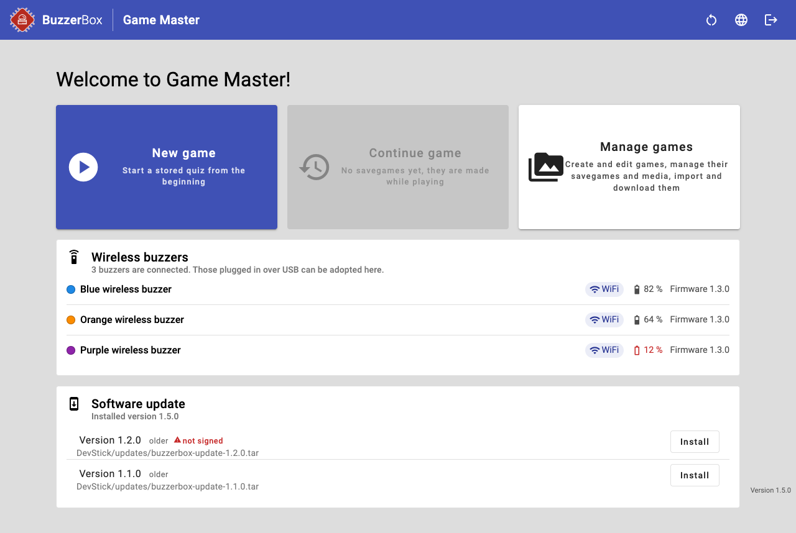
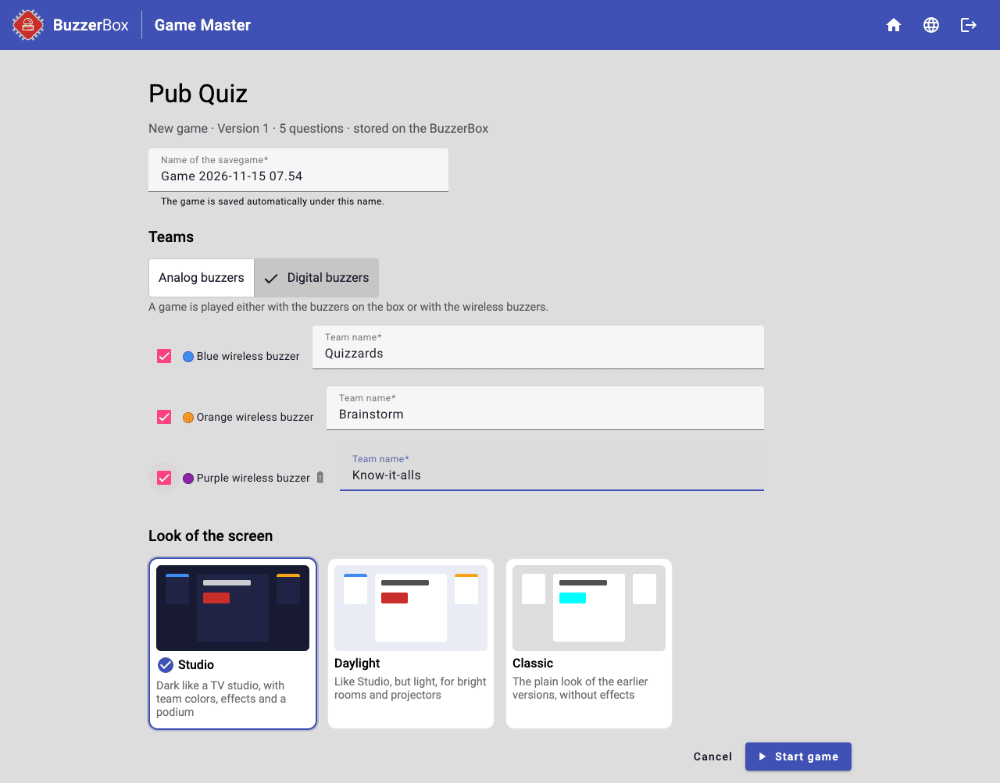
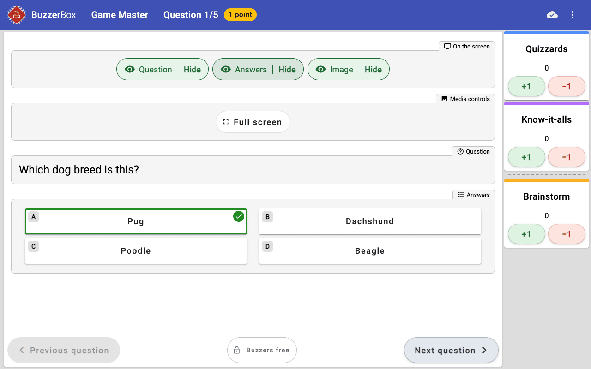
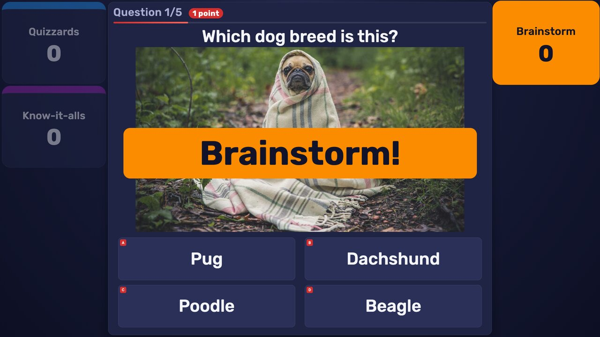
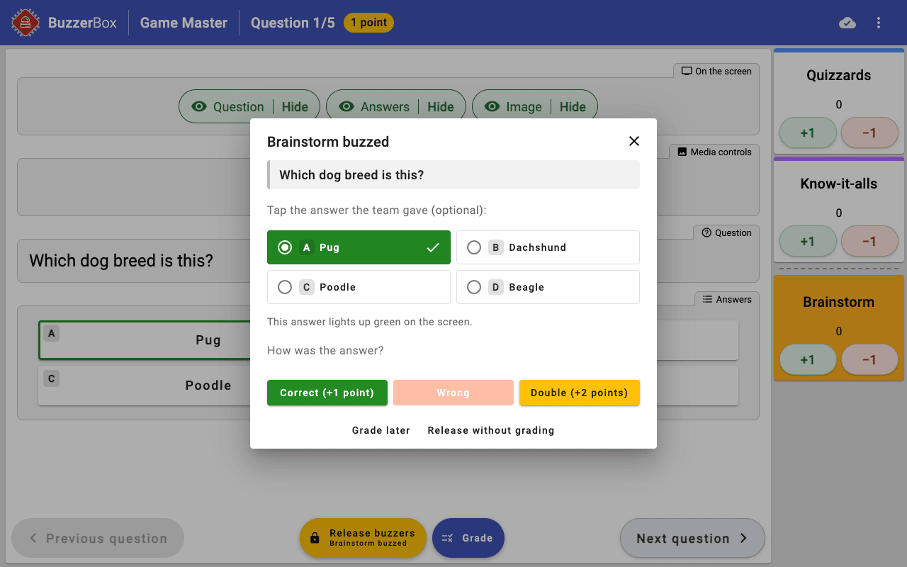
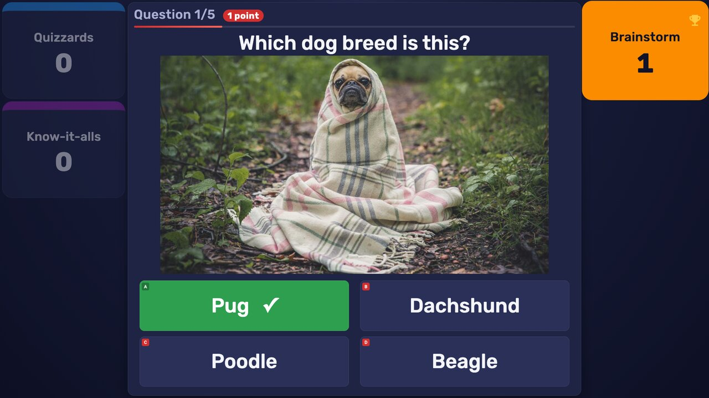
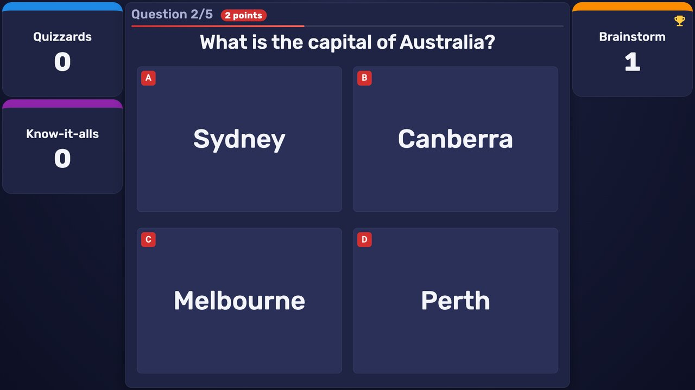
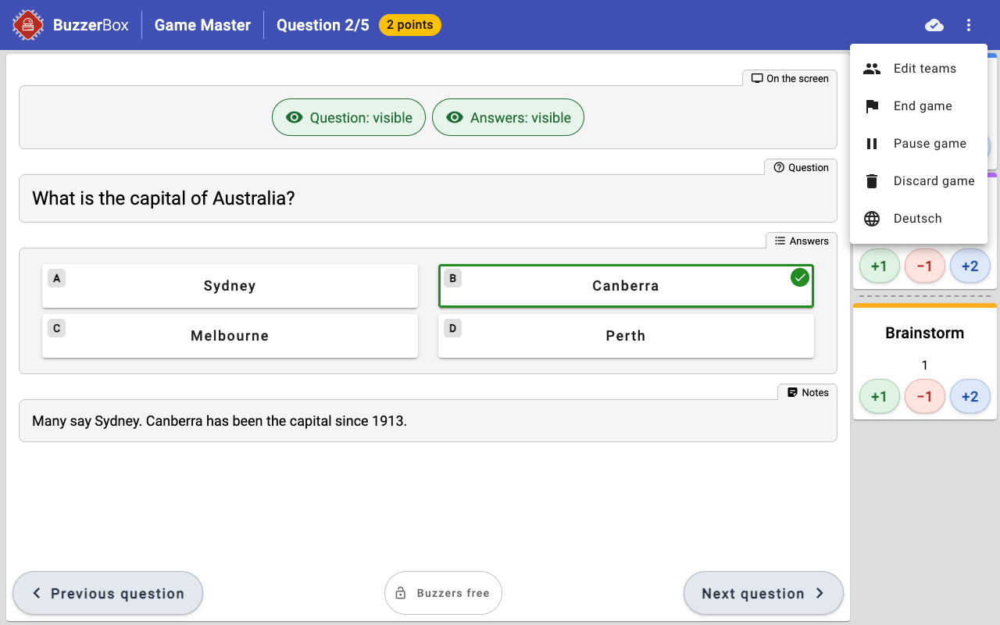
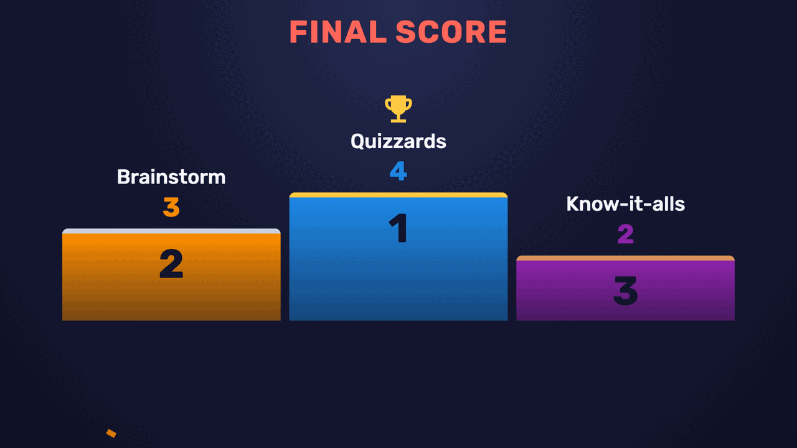

# Ein Spiel leiten

## Spielleitung und Anzeigen

Jedes Gerät, das die BuzzerBox öffnet, wählt auf der ersten Seite eine Rolle:

- **Spielleitung**: dein Handy, Tablet oder Laptop. Damit startest und leitest du das Spiel, bewertest Antworten und
  verwaltest die Spiele. **Es kann immer nur ein Gerät die Spielleitung sein.**
- **Anzeige**: das, was alle sehen: die Fragen, Bilder, Videos und den Punktestand. Der Fernseher am HDMI-Anschluss der
  Box ist von selbst eine Anzeige. Es kann beliebig viele weitere Anzeigen geben, zum Beispiel einen Beamer an einem
  Laptop: Öffne dort die BuzzerBox in einem Browserfenster, wähle *Anzeige* und drücke F11 für Vollbild.

Ein Laptop kann gleichzeitig Spielleitung und Anzeige sein: nimm für jede Rolle ein eigenes Browserfenster.

**Wenn ein anderes Gerät die Spielleitung sein will**, erfährt es, dass schon eins verbunden ist, und kann die
**Steuerung übernehmen**. Ein laufendes Spiel geht dann dort mit dem aktuellen Punktestand weiter, und das erste Gerät
erfährt, dass es die Box nicht mehr steuert. So gibst du an eine zweite Spielleitung ab oder machst an einem anderen
Gerät weiter, wenn deins keinen Akku mehr hat. Hat dein eigenes Gerät nur kurz das WLAN verloren oder neu geladen,
macht es nach ein paar Sekunden von selbst weiter; die Steuerung musst du dann nicht übernehmen.

**Abmelden** (in der Werkzeugleiste auf jeder Seite außer der Spielseite) gibt die Spielleitung auf diesem Gerät ab.

## Ein Spiel starten

Die Startseite der Spielleitung hat drei Einträge:

| Eintrag | Was er tut |
|---|---|
| **Neues Spiel** | Startet ein gespeichertes Spiel ab der ersten Frage. |
| **Spiel fortsetzen** | Spielt einen Spielstand dort weiter, wo aufgehört wurde, mit seinen Teams und Punkten. |
| **Spiele verwalten** | Spiele erstellen, bearbeiten, importieren und herunterladen, siehe [Spiele erstellen](creating-games.md). |

Spiele können auf der BuzzerBox selbst oder auf einem eingesteckten USB-Stick liegen; den Speicherort wählst du oben in
jeder Liste.

Nachdem du ein Spiel gewählt hast, bereitest du es vor:

1. **Name des Spielstands.** Unter diesem Namen wird das Spiel beim Spielen gespeichert. Er beginnt mit Datum und
   Uhrzeit.
2. **Buzzer.** Ein Spiel wird entweder mit den **analogen Buzzern** der Box (den kabelgebundenen) oder mit den
   **digitalen Buzzern** (den Funkbuzzern) gespielt, nicht mit beiden. Hake für jedes Team, das mitspielt, einen Buzzer
   an und gib seinen Namen ein. Ein Team an einem Funkbuzzer mit Gehäusefarbe wird nach ihr benannt, etwa „Blau“. Es
   müssen mindestens zwei Teams spielen, und jedes braucht einen eigenen Namen: Solange zwei denselben haben, sind beide
   mit „Ein anderes Team hat schon diesen Namen“ markiert, und das Spiel lässt sich nicht starten. Ein Funkbuzzer, der
   ausgeschaltet ist oder schläft, ist als nicht verbunden markiert, einer mit fast leerem Akku mit einem Batteriesymbol.
3. **Aussehen der Anzeige**:
   - **Studio**: dunkel wie im Fernsehstudio, mit Teamfarben, Effekten und einem Siegertreppchen am Ende.
   - **Tageslicht**: genauso, aber hell, für helle Räume und Beamer.
   - **Klassisch**: das schlichte Aussehen der früheren Versionen.
4. Fehlen im Spiel Medien (zum Beispiel, weil sie auf einem USB-Stick waren, der nicht eingesteckt ist), listet die
   Seite sie auf. Diese Fragen zeigen dann nichts an.
5. **Spiel starten**, oder **Spiel fortsetzen** für einen Spielstand.

Ein neues Spiel beginnt mit einem **Begrüßungsbildschirm** mit dem Namen des Spiels, und die Buzzer sind gesperrt.
**Spiel starten** auf der Spielseite zeigt die erste Frage und gibt die Buzzer frei.

## Die Spielseite

Die Spielseite zeigt die aktuelle Frage mit ihren Antworten, die Teams mit ihren Punkten und in der Mitte einen großen
Knopf für die Buzzer.

### Wenn ein Team buzzert

1. Das erste Team, das seinen Buzzer drückt, wird **markiert**, und alle Buzzer werden **gesperrt**. Die Anzeige zeigt
   den Namen des Teams, und sein Buzzer leuchtet auf.

   

2. Bei der Spielleitung öffnet sich ein Fenster: **Wie war die Antwort?** Hat die Frage Antwortmöglichkeiten, kannst du
   zuerst die Antwort antippen, die das Team gegeben hat, damit sie auf der Anzeige grün oder rot aufleuchtet.
3. Bewerte sie:
   - **Richtig**: Das Team bekommt die Punkte der Frage, und die richtigen Antworten werden gezeigt. Die Buzzer bleiben
     bis zur nächsten Frage gesperrt.
   - **Falsch**: Je nach Spiel verliert das Team Punkte oder nichts. Die Buzzer werden freigegeben, und die anderen
     Teams dürfen buzzern.
   - **Doppelt** oder **Bonus**, wenn das Spiel es erlaubt: die doppelten Punkte, oder die Punkte plus eins.
   - **Später bewerten**: schließt das Fenster. Die Buzzer bleiben gesperrt, und der große Knopf **Bewerten** öffnet es
     wieder.
   - **Ohne Wertung freigeben**: Niemand bekommt Punkte, und alle Teams dürfen wieder buzzern.

Nach **Richtig** zeigt die Anzeige die richtige Antwort und den neuen Punktestand:

Der große Knopf in der Mitte kann die Buzzer auch jederzeit **freigeben** (**Buzzer freigeben**), ohne zu bewerten. An
einer Box mit kabelgebundenen Buzzern macht ihr Freigabe-Taster dasselbe.

**Punkte von Hand.** Jedes Team hat Knöpfe, um einen Punkt hinzuzufügen oder abzuziehen und um die Punkte der aktuellen
Frage zu vergeben, etwa für eine Frage, die ohne Buzzer beantwortet wurde.

### Fragen und Antworten auf der Anzeige

- **Vorherige Frage** und **Nächste Frage** wechseln zwischen den Fragen. Nach der letzten Frage steht dort
  **Spiel beenden**.
- Die Frage und ihre Antworten lassen sich auf der Anzeige zeigen oder verbergen. Tippe sie an, um sie zu zeigen. Je
  nachdem, wie das Spiel erstellt wurde, beginnt eine Frage mit verborgenen Antworten oder zeigt sie erst nach ihrem
  Video, Audio oder ihrer Bildserie.
- **Notizen**, falls die Frage welche hat, sind nur für dich; die Anzeige zeigt sie nie.

### Medien

Eine Frage mit Bild, Video, Audio oder Bildserie hat bei der Spielleitung ihre Mediensteuerung:

- **Abspielen** und **Pausieren**, und **Von vorne** für Video und Audio. Die Medien laufen auf allen Anzeigen
  gleichzeitig.
- **Vorheriges Bild**, **Bild zeigen** und **Nächstes Bild** für eine Bildserie, und **Abschließen** nach dem letzten.
- **Vollbild** zeigt das Medium über die ganze Anzeige.
- **Ton**: die Lautstärke auf allen Anzeigen, und stumm schalten. Sie bleibt für das ganze Spiel gleich.

Zeigt eine Anzeige *Klicken, um den Ton einzuschalten*, hat ihr Browser den Ton blockiert: Klicke einmal in das Fenster
dieser Anzeige. Der Fernseher an der Box braucht das nie.

## Während des Spiels: das Menü ⋮

Die Werkzeugleiste der Spielseite zeigt, wann das Spiel zuletzt gespeichert wurde (das Wolkensymbol), und hat ein
Menü ⋮ mit:

| Eintrag | Was er tut |
|---|---|
| **Teams bearbeiten** | Teams umbenennen, oder während des Spiels hinzufügen und entfernen. Ein entferntes Team verliert seine Punkte. Wie beim Start können zwei Teams nicht denselben Namen haben. |
| **Sprache** | Deutsch oder Englisch, für die Spielleitung und alle Anzeigen. |
| **Spiel beenden** | Beendet das Spiel und zeigt den Endstand mit den Siegern. |
| **Spiel pausieren** | Geht zurück zur Startseite und behält den Spielstand, um später mit **Spiel fortsetzen** weiterzuspielen. |
| **Spiel verwerfen** | Geht zurück zur Startseite und **löscht den Spielstand**, auch wenn er schon vorher gespielt wurde. |

Jeder Eintrag fragt vorher nach.

## Speichern

Die BuzzerBox **speichert das Spiel automatisch**, etwa eine Sekunde nach jeder Änderung: die Teams, die Punkte, die
aktuelle Frage und was gezeigt wird. Von Hand speichern musst du nie. Das Wolkensymbol in der Werkzeugleiste sagt dir,
wann und wo zuletzt gespeichert wurde. Liegt der Spielstand auf einem USB-Stick, der abgezogen wird, meldet es, dass
das Speichern fehlgeschlagen ist, und versucht es weiter; steck den Stick wieder ein.

Das heißt:

- Lädt dein Gerät neu, ist sein Akku leer oder verliert es das WLAN, öffne die Spielleitung wieder, und das Spiel ist
  noch da.
- Verliert die Box den Strom, lässt sich das Spiel nach dem Neustart mit **Spiel fortsetzen** weiterspielen. Höchstens
  die letzte Sekunde geht verloren.
- Ein beendetes Spiel bleibt in der Liste der Spielstände, als beendet markiert.

## Nach dem Spiel

**Spiel beenden** zeigt den Endstand auf den Anzeigen. **Zur Startseite** startet das nächste Spiel. **Server
zurücksetzen** (auf der Startseite) lässt alle Geräte von vorne anfangen, zum Beispiel wenn etwas hängt.

