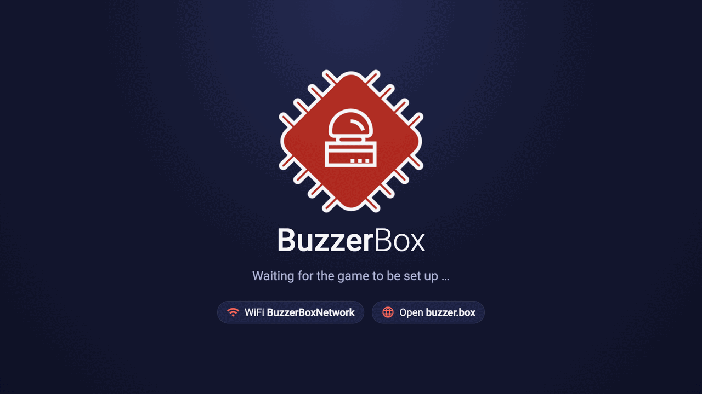
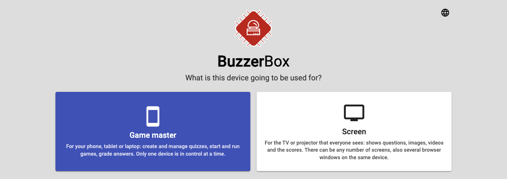
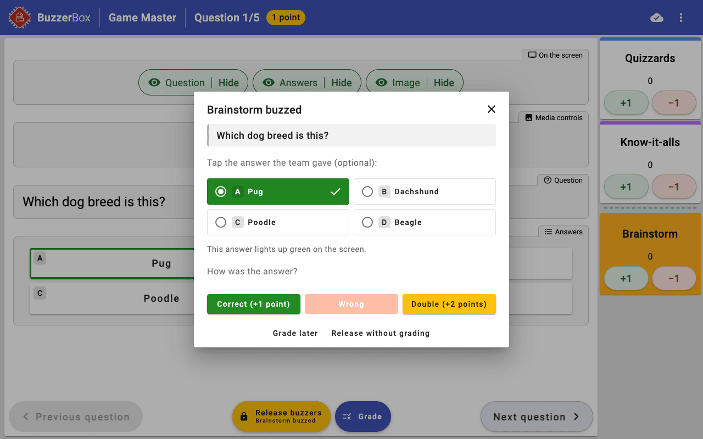

# Schnellstart

## 1. Die Box aufbauen

1. Schließe den **Fernseher** (oder Beamer) an den HDMI-Anschluss der Box an und schalte ihn ein. Der Ton von Videos und
   Audio kommt ebenfalls über den Fernseher.
2. Schließe die **Buzzer** an: kabelgebundene Buzzer an die Buchsen der Box. Funkbuzzer wachen auf, wenn du ihren Knopf
   drückst (dieser erste Druck zählt nicht).
3. Schließe das **Netzteil** an. Nach etwa einer Minute zeigt der Fernseher den Warte-Bildschirm mit dem Namen des
   WLANs und der Adresse, die du öffnen musst.

   

## 2. Mit dem WLAN der Box verbinden

Verbinde dein Handy, Tablet oder deinen Laptop mit dem WLAN **`BuzzerBoxNetwork`** (oder dem Namen, der auf deiner Box
steht). Das Passwort steht auf der Box oder in ihren Unterlagen. Das WLAN hat kein Internet; wenn dein Handy fragt, ob
es verbunden bleiben soll, sag ja.

## 3. Die Spielleitung öffnen

Öffne **`http://buzzer.box`** im Browser (oder `http://10.0.0.5`, falls das nicht klappt) und wähle **Spielleitung**.
Es kann immer nur ein Gerät die Spielleitung sein; der Fernseher ist schon die Anzeige.

## 4. Ein Spiel starten

1. Wähle auf der Startseite **Neues Spiel** und dann ein Spiel. Noch kein Spiel da? Wähle **Spiele verwalten**, um eins
   zu erstellen oder hochzuladen, siehe [Spiele erstellen](creating-games.md).
2. Wähle die **Buzzer** (die analogen Buzzer der Box oder die Funkbuzzer), hake für jedes Team einen Buzzer an und gib
   den Namen des Teams ein. Es müssen mindestens zwei Teams spielen.
3. Wähle das **Aussehen der Anzeige** und tippe auf **Spiel starten**.
4. Die Anzeige zeigt eine Begrüßung. Tippe noch einmal auf **Spiel starten**, um die erste Frage zu zeigen und die
   Buzzer freizugeben.

## 5. Spielen

- Wenn ein Team seinen Buzzer drückt, sind alle anderen gesperrt, und ein Fenster fragt dich, wie die Antwort war:
  **Richtig** oder **Falsch**. Nach einer falschen Antwort dürfen die anderen Teams wieder buzzern.

  

- **Nächste Frage** geht weiter. Nach der letzten Frage zeigt **Spiel beenden** die Sieger.
- Das Spiel wird **ständig gespeichert**. Wenn dein Gerät neu lädt oder kurz das WLAN verliert, geht es an derselben
  Stelle weiter.

Um für heute aufzuhören, beende oder pausiere das Spiel und schalte die Box dann am Netzteil aus. Ein laufendes Spiel
lässt sich später unter **Spiel fortsetzen** weiterspielen.

Etwas klappt nicht? Siehe [Fehlerbehebung](troubleshooting.md).
