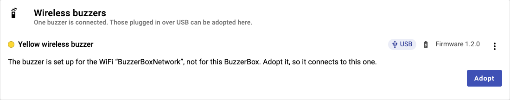
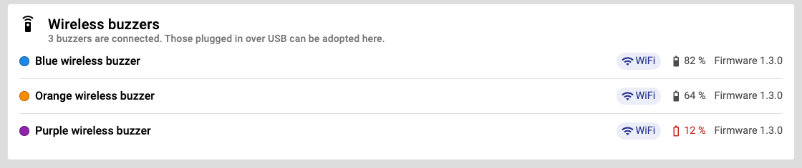

# Funkbuzzer

Funkbuzzer laufen mit Akku und verbinden sich über ihr WLAN mit der BuzzerBox. Ein Spiel wird entweder mit ihnen oder
mit den kabelgebundenen Buzzern der Box gespielt, nicht mit beiden.

## Wie sie sich verhalten

- Ein Buzzer **schläft**, bis sein Knopf gedrückt wird. Dieser erste Druck weckt ihn nur; er buzzert nicht.
- Wach verbindet er sich mit dem WLAN der Box, was ein paar Sekunden dauert (beim ersten Mal nach dem Laden oder
  Einschalten etwas länger).
- **Während eines Spiels mit den Funkbuzzern bleibt er wach**, auch wenn dein Gerät gerade weg ist.
- Ohne Spiel schläft er 10 Minuten nach dem letzten Druck wieder ein, oder nach 30 Sekunden, wenn er die Box nicht
  findet.
- Startet die Box neu, finden die Buzzer sie von selbst wieder.

## Einen Buzzer übernehmen

Ein neuer Buzzer kennt das WLAN der Box noch nicht; er blinkt magenta. Er bekommt es über USB:

1. Öffne die **Startseite** der Spielleitung. Die Liste **Funkbuzzer** zeigt die verbundenen Buzzer.
2. Steck den Buzzer mit einem USB-Kabel an einen USB-Anschluss der BuzzerBox. Er erscheint in der Liste mit einem
   **USB**-Abzeichen. Schlief er und erscheint nicht, drück seinen Knopf. Ein Buzzer, der für eine andere Box
   eingerichtet wurde, sagt, welches WLAN er hat.

   

3. Wähle die **Farbe seines Gehäuses**, wenn er ein farbiges Gehäuse hat (ab Firmware 1.2.0). Der Buzzer merkt sie sich,
   und die Anzeigen zeigen sein Team in dieser Farbe.
4. Tippe auf **Übernehmen**. Das Licht des Buzzers blinkt dreimal grün, und die Liste meldet *Übernommen und verbunden*.
   Du kannst ihn jetzt abstecken.

Ein Buzzer, der das WLAN dieser Box schon hat, wird als übernommen gezeigt, mit **Erneut übernehmen**. Übernimm einen
Buzzer erneut, wenn er mit einer anderen Box benutzt wurde, und **nachdem der WLAN-Name oder das Passwort der Box
geändert wurde**: Buzzer behalten das WLAN, das sie bekommen haben.

Um die Farbe eines übernommenen Buzzers zu ändern, steck ihn wieder an, wähle in seinem Menü ⋮ (*Weitere
Einstellungen*) *Farbe des Gehäuses ändern*, wähle die Farbe und tippe auf **Farbe übernehmen**.

## Namen und Farben

Ein Buzzer wird nach der Farbe seines Gehäuses benannt, zum Beispiel *Blauer Wireless Buzzer*, und ein neues Team daran
nach der Farbe: „Blau“, „Blau 2“. Haben zwei Buzzer dieselbe Farbe, unterscheidet sie das Ende ihrer Adresse, und die
Anzeigen unterscheiden ihre Teams nur am Namen; gib ihnen verschiedene Farben. Ein Buzzer ohne Farbe heißt *Funkbuzzer*
mit dem Ende seiner Adresse.

## Akku und Laden

- Das **USB-Kabel lädt** den Buzzer, an der Box oder an jedem USB-Ladegerät. Das Laden über USB wird in der Liste
  angezeigt.
- Die Liste auf der Startseite zeigt den **Akku** jedes Buzzers: in Prozent bei den neueren Buzzern (Feather ESP32-S3)
  und bei allen eine Warnung, wenn er fast leer ist.
- Ist der Akku schwach, blinkt der Buzzer alle 5 Sekunden orange, und die Spielleitung zeigt ein Batteriesymbol neben
  ihm, auch beim Vorbereiten eines Spiels. Lade ihn vor dem nächsten Spiel.

## Was das Licht bedeutet

| Licht am Buzzer | Bedeutung |
|---|---|
| blau, blinkend | Verbindet sich mit der Box |
| magenta, blinkend | Er hat noch kein WLAN: [übernimm ihn](#einen-buzzer-übernehmen) |
| gelb, blinkend | Er hat die Box verloren und versucht es weiter |
| türkis, alle 2 s kurz | Verbunden, es läuft kein Spiel |
| grün | Spiel läuft, die Buzzer sind frei |
| schwach rot | Ein anderes Team hat gebuzzert |
| weiß, blitzend | **Dieses Team hat gebuzzert** |
| grün, 3-mal blinkend | Er hat das WLAN über USB bekommen |
| rot, 3-mal blinkend | Er hat WLAN-Einstellungen bekommen, die er nicht nutzen kann |
| alle 5 s orange | Der Akku ist schwach |

## Wenn ein Buzzer offline ist

Beim Vorbereiten eines Spiels ist ein Buzzer, der nicht verbunden ist, als offline markiert, und *Kein Funkbuzzer ist
verbunden* heißt, dass keiner verbunden ist. Dann:

1. **Drück seinen Knopf**, um ihn zu wecken, und warte ein paar Sekunden.
2. Schau auf sein Licht: **Magenta** heißt, er kennt das WLAN dieser Box nicht, also
   [übernimm ihn](#einen-buzzer-übernehmen). **Gelb** heißt, er erreicht die Box nicht: Bring ihn näher heran, oder
   prüfe, ob die Box an ist.
3. Gar kein Licht: Der Akku ist wahrscheinlich leer. Lade ihn über USB.
4. Immer noch nichts: Steck ihn per USB an die Box. Zeigt die Liste ihn, übernimm ihn erneut.

Ein Buzzer bleibt in der Liste, solange die Box an ist, auch wenn er offline ist, und ein Team behält seinen Buzzer,
wenn er zurückkommt.
