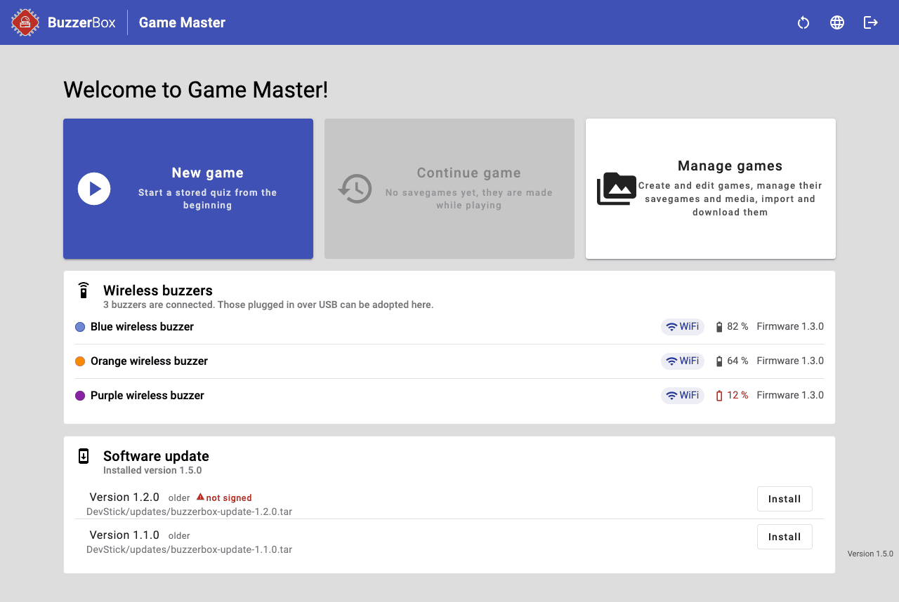
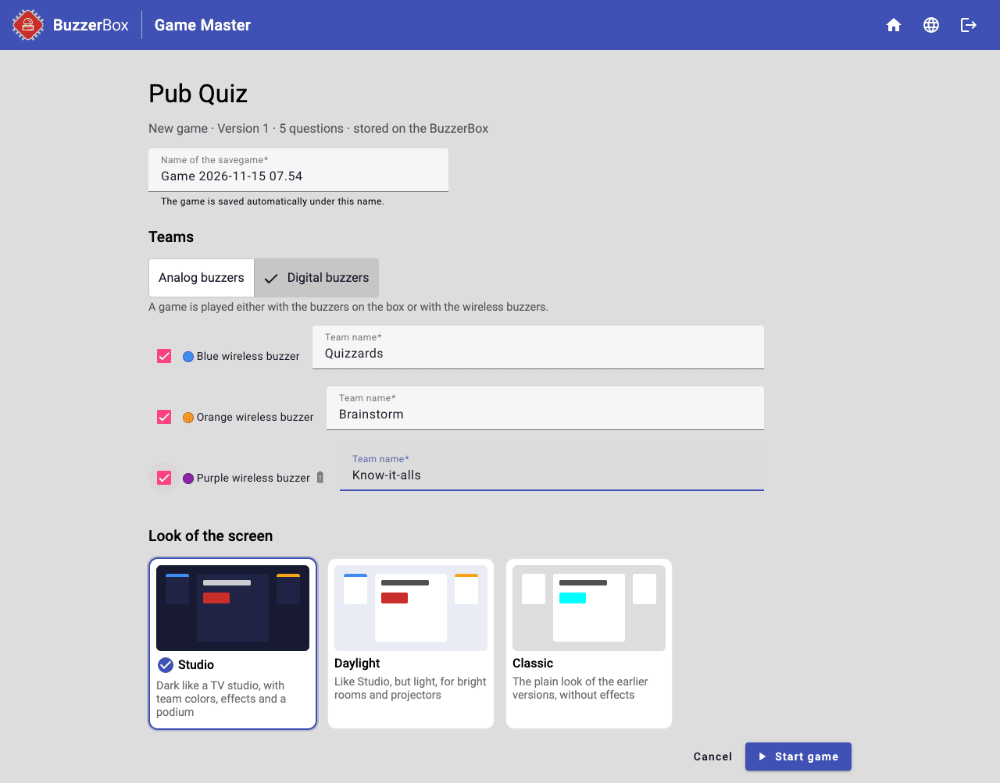
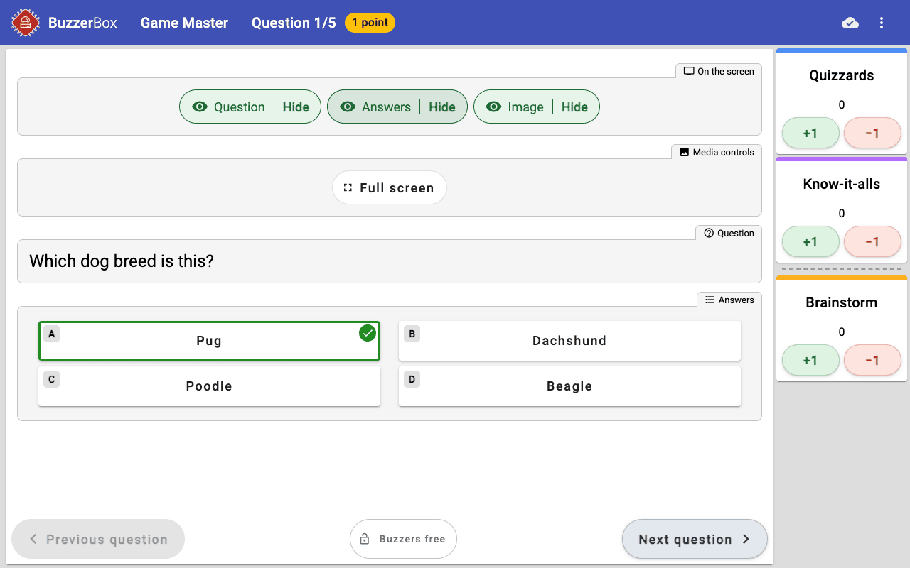
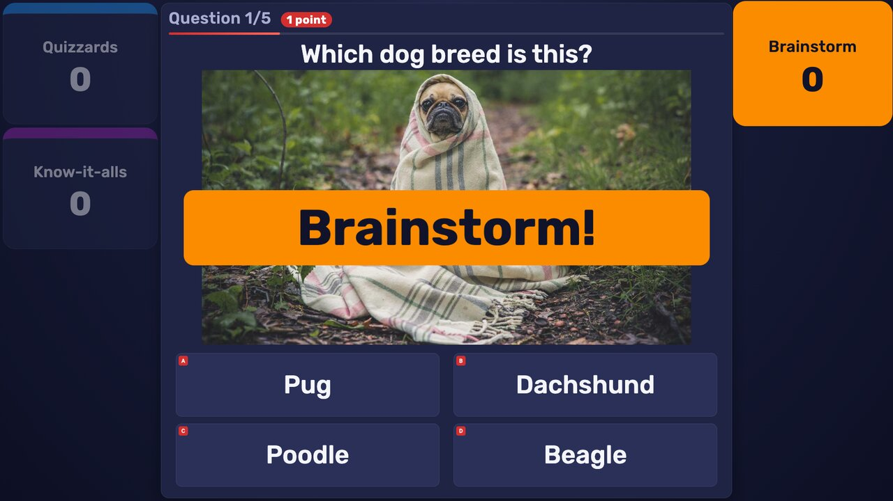
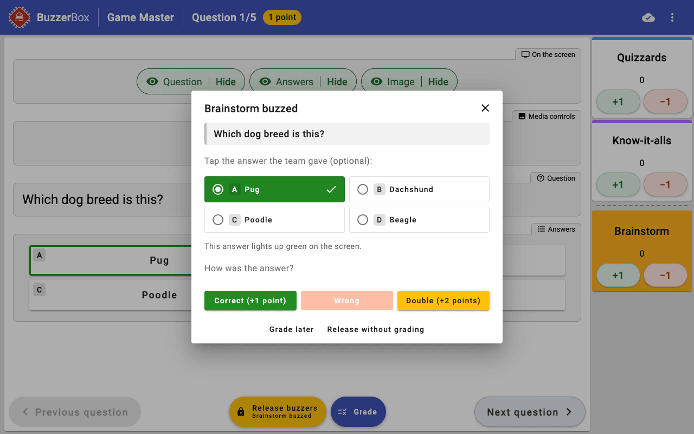
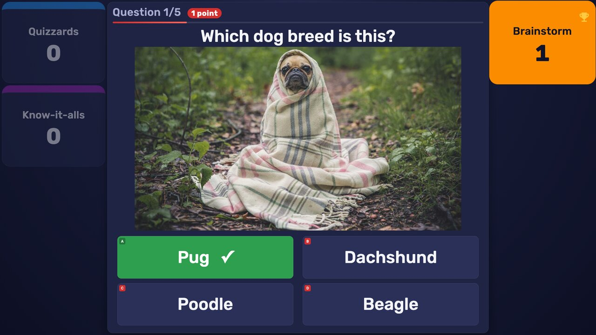
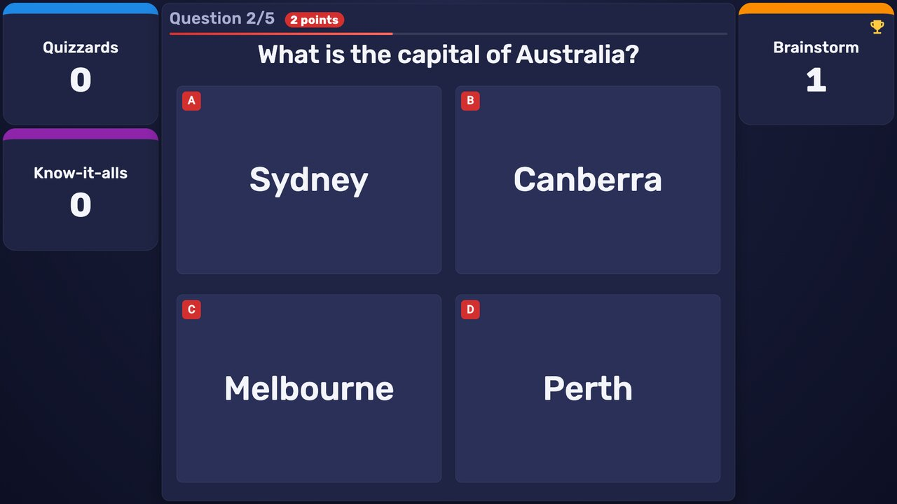
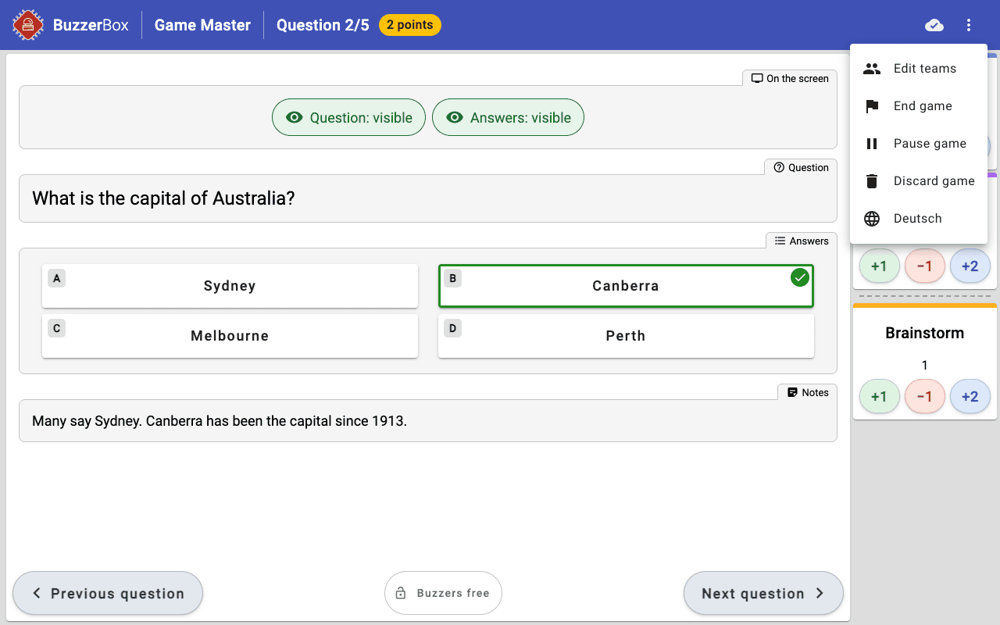
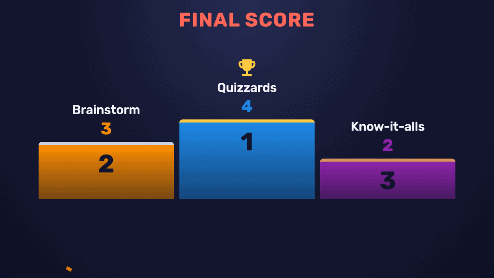

# Hosting a game

## Game master and screens

Every device that opens the BuzzerBox chooses a role on its first page:

- **Game master** (*Spielleitung*): your phone, tablet or laptop. It starts and runs the game, grades answers and
  manages the games. **Only one device can be the game master at a time.**
- **Screen** (*Anzeige*): what everyone sees: the questions, images, videos and the scores. The TV on the box's HDMI
  port is a screen by itself. There can be any number of further screens, for example a projector on a laptop:
  open the BuzzerBox in a browser window there, choose *Screen* and press F11 for full screen.

A laptop can be the game master and a screen at the same time: use one browser window for each.

**When another device wants to be the game master**, it is told that one is connected already, and can **take
control** (*Steuerung übernehmen*). A running game then carries on there with the current scores, and the first device
is told it no longer controls the box. This is how you hand over to a second host, or carry on from another device
when yours ran out of battery. If your own device only lost the WiFi or was reloaded, it carries on by itself after a
few seconds; you don't need to take control.

**Log out** (*Abmelden*, in the toolbar on every page but the play page) gives up being the game master on this device.

## Starting a game

The game master's home page has three entries:

| Entry | What it does |
|---|---|
| **New game** (*Neues Spiel*) | Starts a stored game from the first question. |
| **Continue game** (*Spiel fortsetzen*) | Carries on with a savegame where it left off, with its teams and points. |
| **Manage games** (*Spiele verwalten*) | Creates, edits, imports and downloads games, see [creating games](creating-games.md). |

Games can be stored on the BuzzerBox itself or on a USB stick plugged into it; the storage location is chosen at the
top of each list.

After choosing a game, you prepare it:

1. **Name of the savegame.** The game is saved under this name while you play. It starts with the date and time.
2. **Buzzers.** A game is played either with the box's **analog buzzers** (the wired ones) or with the **digital
   buzzers** (the wireless ones), not with both. Tick a buzzer for each team that plays and type its name. A team on a
   wireless buzzer with a case color is named after it, like "Blue". At least two teams have to play. A wireless buzzer
   that is switched off or asleep is marked as not connected, and one with an almost empty battery with a battery icon.
3. **Look of the screen** (*Aussehen der Anzeige*):
   - **Studio**: dark like a TV studio, with team colors, effects and a podium at the end.
   - **Daylight** (*Tageslicht*): the same, but light, for bright rooms and projectors.
   - **Classic** (*Klassisch*): the plain look of earlier versions.
4. If media are missing in the game (for example since they were on a USB stick that isn't plugged in), the page lists
   them. Those questions show nothing then.
5. **Start game** (*Spiel starten*), or **Continue game** for a savegame.

A new game starts with a **welcome screen** with the game's name, and the buzzers are locked. **Start game** on the play
page shows the first question and releases the buzzers.

## The play page

The play page shows the current question with its answers, the teams with their points, and a big button in the
middle for the buzzers.

### When a team buzzes

1. The first team to press its buzzer is **marked**, and all buzzers are **locked**. The screen shows the team's name,
   and its buzzer lights up.

   

2. A window opens on the game master: **How was the answer?** If the question has answer options, you can first tap the
   answer the team gave, so it lights up green or red on the screen.
3. Grade it:
   - **Correct** (*Richtig*): the team gets the question's points, and the correct answers are shown. The buzzers stay
     locked until the next question.
   - **Wrong** (*Falsch*): depending on the game, the team loses points or nothing. The buzzers are released, and the
     other teams may buzz.
   - **Double** (*Doppelt*) or **Bonus**, if the game allows it: twice the points, or the points plus one.
   - **Grade later** (*Später bewerten*): closes the window. The buzzers stay locked, and the big button **Grade**
     (*Bewerten*) opens it again.
   - **Release without grading** (*Ohne Wertung freigeben*): nobody gets points, and all teams may buzz again.

After **Correct**, the screen shows the correct answer and the new score:

The big button in the middle also **releases the buzzers** (*Buzzer freigeben*) at any time, without grading. On a box
with wired buzzers, its release button does the same.

**Points by hand.** Each team has buttons to add or deduct a point, and to award the points of the current question,
for example for a question answered without buzzers.

### Questions and answers on the screen

- **Previous question** and **Next question** (*Nächste Frage*) move between the questions. After the last question,
  **End game** (*Spiel beenden*) takes its place.
- The question and its answers can be shown or hidden on the screen. Tap them to show them. A question may start with
  them hidden, or show them only after its video, audio or slideshow, depending on how the game was made.
- **Notes**, if the question has any, are only for you; the screen never shows them.

### Media

A question with an image, video, audio or slideshow has its media controls on the game master:

- **Play** and **Pause**, and **Restart** (*Von vorne*) for video and audio. The media play on every screen at the
  same time.
- **Previous image**, **Show image** and **Next image** for a slideshow, and **Finish** after the last one.
- **Full screen** (*Vollbild*) shows the medium over the whole screen.
- **Sound**: the volume on all screens, and mute. It stays the same for the whole game.

If a screen shows *Click to turn the sound on*, the browser of that screen blocked the sound: click once into that
screen's window. The TV on the box never needs that.

## During the game: the ⋮ menu

The toolbar of the play page shows when the game was last saved (the cloud icon), and has a menu ⋮ with:

| Entry | What it does |
|---|---|
| **Edit teams** (*Teams bearbeiten*) | Rename teams, or add and remove them during the game. A removed team loses its points. |
| **Language** | German or English, for the game master and all screens. |
| **End game** (*Spiel beenden*) | Ends the game and shows the final score with the winners. |
| **Pause game** (*Spiel pausieren*) | Goes back to the home page and keeps the savegame, to carry on later with **Continue game**. |
| **Discard game** (*Spiel verwerfen*) | Goes back to the home page and **deletes the savegame**, even if it was played before. |

Each asks for confirmation first.

## Saving

The BuzzerBox **saves the game automatically** about a second after each change: the teams, the points, the current
question and what is shown. You never need to save by hand. The cloud icon in the toolbar tells you when it was saved
last, and where. If the savegame is on a USB stick that is pulled out, it says that saving failed and keeps trying;
plug the stick back in.

This means:

- If your device reloads, runs out of battery or loses the WiFi, open the game master again, and the game is still
  there.
- If the box loses power, the game can be continued with **Continue game** after it starts again. At most the last
  second is lost.
- An ended game stays in the list of savegames, marked as ended.

## After the game

**End game** shows the final score on the screens. **To the home page** starts the next game. **Reset server**
(*Server zurücksetzen*, on the home page) makes all devices start over, for example when something got stuck.

