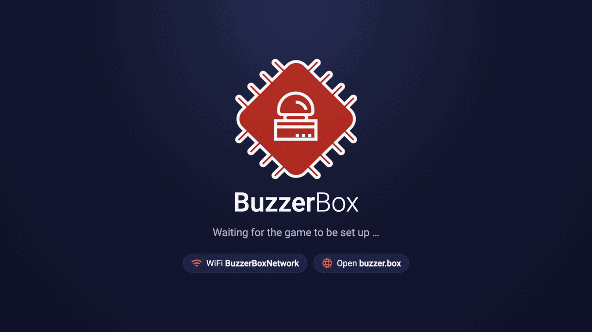
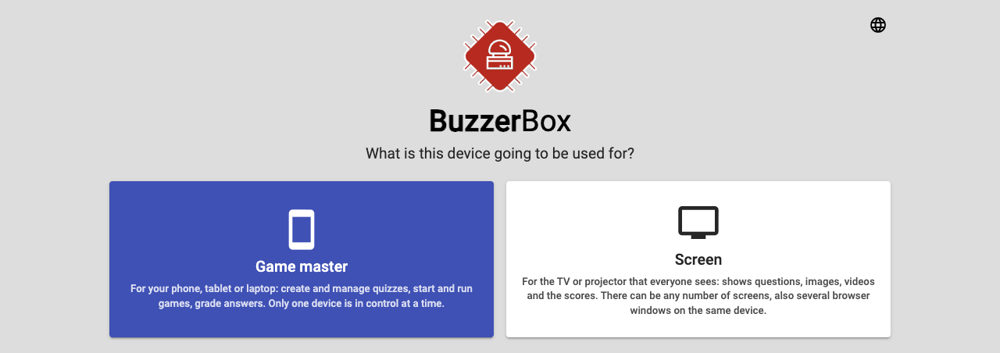
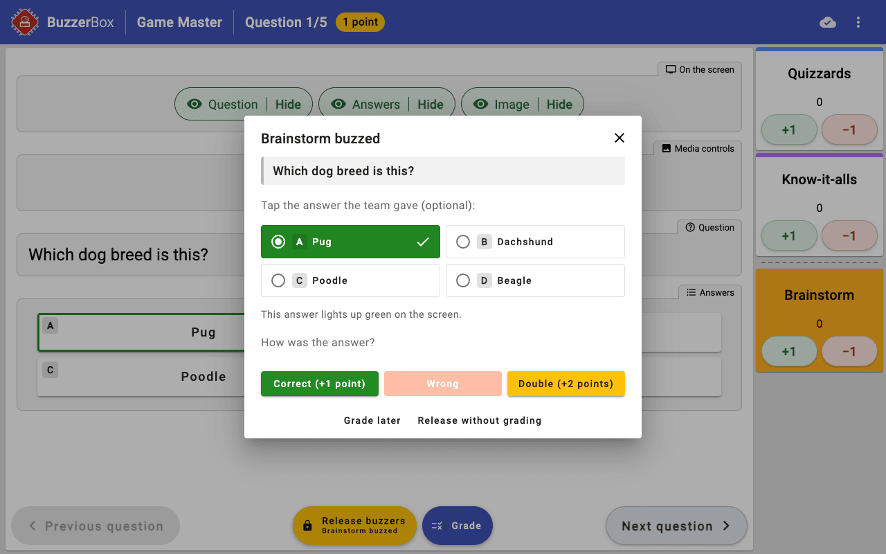

# Quick start

## 1. Set up the box

1. Connect the **TV** (or projector) to the box's HDMI port and switch it on. The sound of videos and audio comes
   through the TV as well.
2. Plug in the **buzzers**: wired buzzers into the ports of the box. Wireless buzzers wake up when you press their
   button (that first press doesn't count).
3. Connect the **power supply**. After about a minute, the TV shows the waiting screen with the name of the WiFi and the
   address to open.

   

## 2. Join the box's WiFi

On your phone, tablet or laptop, join the WiFi **`BuzzerBoxNetwork`** (or the name written on your box). The password
is on the box or in its papers. The WiFi has no internet; if your phone asks whether to stay connected, say yes.

## 3. Open the game master

Open **`http://buzzer.box`** in the browser (or `http://10.0.0.5` if that doesn't work) and choose **Game master**
(*Spielleitung*). Only one device can be the game master at a time; the TV is the screen already.

## 4. Start a game

1. On the home page, choose **New game** (*Neues Spiel*) and then a game. No game yet? Choose **Manage games**
   (*Spiele verwalten*) to create or upload one, see [creating games](creating-games.md).
2. Choose the **buzzers** (the box's analog buzzers or the wireless ones), tick a buzzer for each team and type the
   team's name. At least two teams have to play.
3. Choose the **look of the screen** and tap **Start game** (*Spiel starten*).
4. The screen shows a welcome. Tap **Start game** once more to show the first question and release the buzzers.

## 5. Play

- When a team presses its buzzer, all others are locked, and a window asks you to grade the answer: **Correct**
  (*Richtig*) or **Wrong** (*Falsch*). After a wrong answer, the other teams may buzz again.

  

- **Next question** (*Nächste Frage*) moves on. After the last question, **End game** (*Spiel beenden*) shows the
  winners.
- The game is **saved all the time**. If your device reloads or loses the WiFi for a moment, it carries on at the same
  point.

To stop for the day, switch the box off at its power supply after ending or pausing the game. A game that was
running can be continued later under **Continue game** (*Spiel fortsetzen*).

Something doesn't work? See [troubleshooting](troubleshooting.md).
