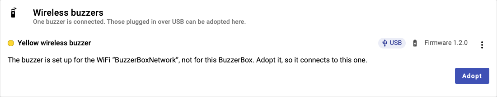
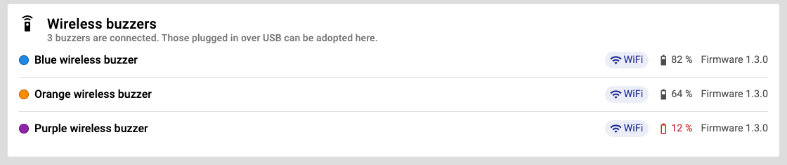

# Wireless buzzers

Wireless buzzers run on a battery and connect to the BuzzerBox over its WiFi. A game is played either with them or
with the box's wired buzzers, not with both.

## How they behave

- A buzzer **sleeps** until its button is pressed. That first press only wakes it; it doesn't buzz.
- Awake, it connects to the box's WiFi, which takes a few seconds (a little longer the first time after it was charged
  or switched on).
- **During a game with the wireless buzzers, it stays awake**, also while your device is away.
- Without a game, it goes back to sleep 10 minutes after its last press, or after 30 seconds if it can't find the box.
- When the box restarts, the buzzers find it again by themselves.

## Adopting a buzzer

A new buzzer doesn't know the box's WiFi yet; it blinks magenta. It gets it over USB:

1. Open the game master's **home page**. The list **Wireless buzzers** shows the connected buzzers.
2. Plug the buzzer into a USB port of the BuzzerBox with a USB cable. It appears in the list with a **USB** badge.
   If it was asleep and doesn't appear, press its button. A buzzer that was set up for another box says which WiFi it
   has.

   

3. Choose the **color of its case**, if it has a colored case (firmware 1.2.0 or later). The buzzer keeps it, and the
   screens show its team in that color.
4. Tap **Adopt** (*Übernehmen*). The buzzer's light flashes green three times, and the list says *Adopted and
   connected*. You can unplug it now.

A buzzer that has this box's WiFi already shows as adopted, with **Adopt again** (*Erneut übernehmen*). Adopt a buzzer
again when it was used with another box, and **after the box's WiFi name or password was changed**: buzzers keep the
WiFi they were given.

To change the color of an adopted buzzer, plug it in again, choose *Change the color of the case* in its menu ⋮
(*More settings*), pick the color and tap **Apply the color**.

## Playing over USB

A buzzer that is plugged into the BuzzerBox **plays over the USB cable** (firmware 1.4.0 or later): its presses don't
go over the WiFi then, so a crowded WiFi can't delay them. That's handy for a buzzer that sits next to the box anyway,
or when the WiFi is unreliable at a venue.

- It switches by itself: a few seconds after it is plugged in, the **USB** badge in the list is highlighted, and the
  list says *Plays over USB while it is plugged in*. **Unplug it at any time**, also during a game: it plays over the
  WiFi right away, without you doing anything. Plugged in again, it goes back to USB.
- The **WiFi** badge next to it means its WiFi works, so it can be unplugged. A buzzer that hasn't been adopted plays
  over USB too, but can't play once it is unplugged: adopt it for that.
- It charges meanwhile, and stays awake while it plays over USB.

## Names and colors

A buzzer is named after the color of its case, for example *Blue wireless buzzer*, and a new team on it after the
color: "Blue", "Blue 2". If two buzzers have the same color, the end of their address tells them apart, and the
screens only tell their teams apart by name; give them different colors. A buzzer without a color is called
*Wireless buzzer* with the end of its address.

## Battery and charging

- The **USB cable charges** the buzzer, from the box or any USB charger. Charging over USB is shown in the list.
- The list on the home page shows each buzzer's **battery**: in percent for the newer buzzers (Feather ESP32-S3), and a
  warning for all when it is almost empty.
- When the battery is low, the buzzer blinks orange every 5 seconds, and the game master shows a battery icon next to
  it, also when preparing a game. Charge it before the next game.

## What the light means

| Light on the buzzer | Meaning |
|---|---|
| blue, blinking | Connecting to the box |
| magenta, blinking | It has no WiFi yet: [adopt it](#adopting-a-buzzer) |
| yellow, blinking | It lost the box and keeps trying |
| cyan, a short blink every 2 s | Connected, no game is running |
| green | Game running, the buzzers are free |
| dim red | Another team buzzed |
| white, flashing | **This team buzzed** |
| green, 3 flashes | It got the WiFi over USB |
| red, 3 flashes | It got WiFi settings it can't use |
| an orange blink every 5 s | The battery is low |

## When a buzzer is offline

When preparing a game, a buzzer that isn't connected is marked as offline, and *No wireless buzzer is connected* means
none is. Then:

1. **Press its button** to wake it, and wait a few seconds.
2. Look at its light: **magenta** means it doesn't know this box's WiFi, so [adopt it](#adopting-a-buzzer). **Yellow**
   means it can't reach the box: bring it closer, or check that the box is on.
3. No light at all: the battery is probably empty. Charge it over USB.
4. Still nothing: plug it into the box over USB. If the list shows it, adopt it again.

A buzzer stays in the list while the box is on, even when it is offline, and a team keeps its buzzer when it comes back.
