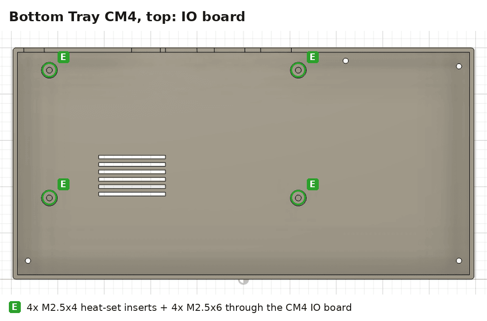
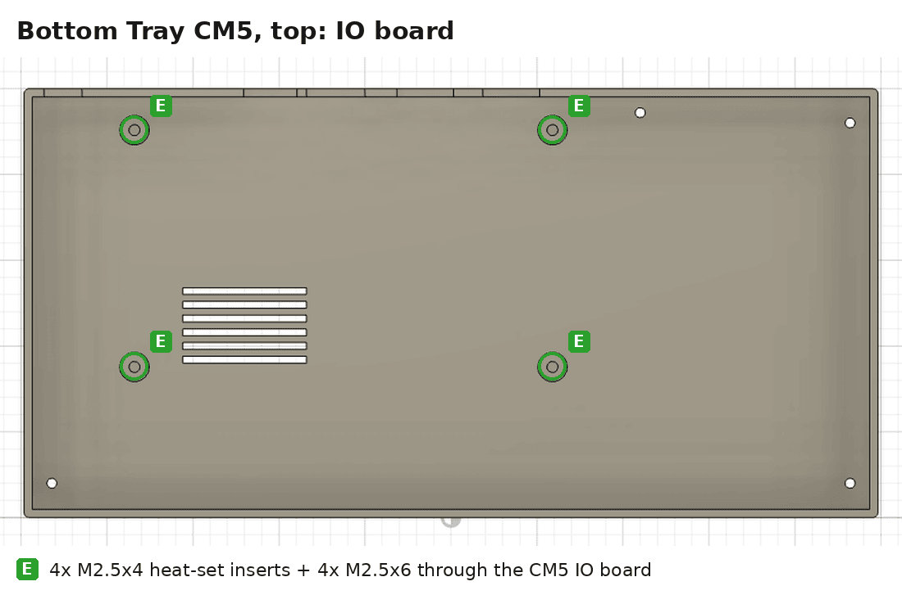
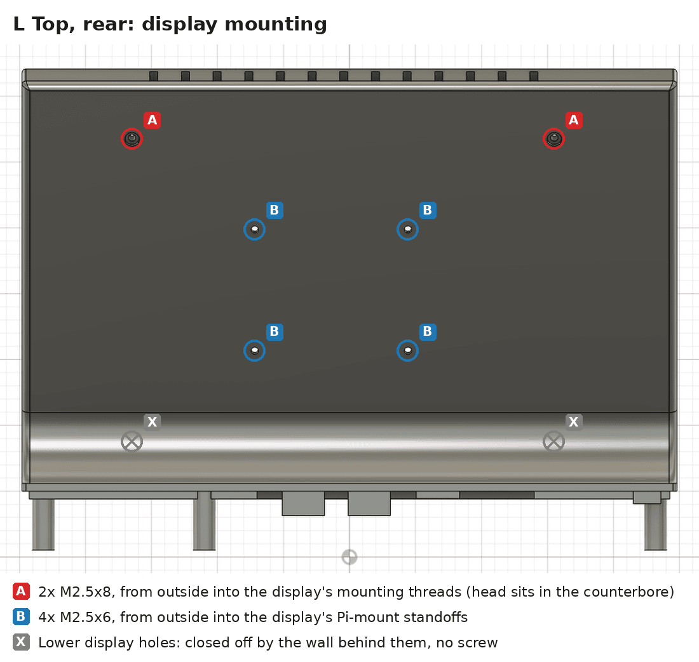
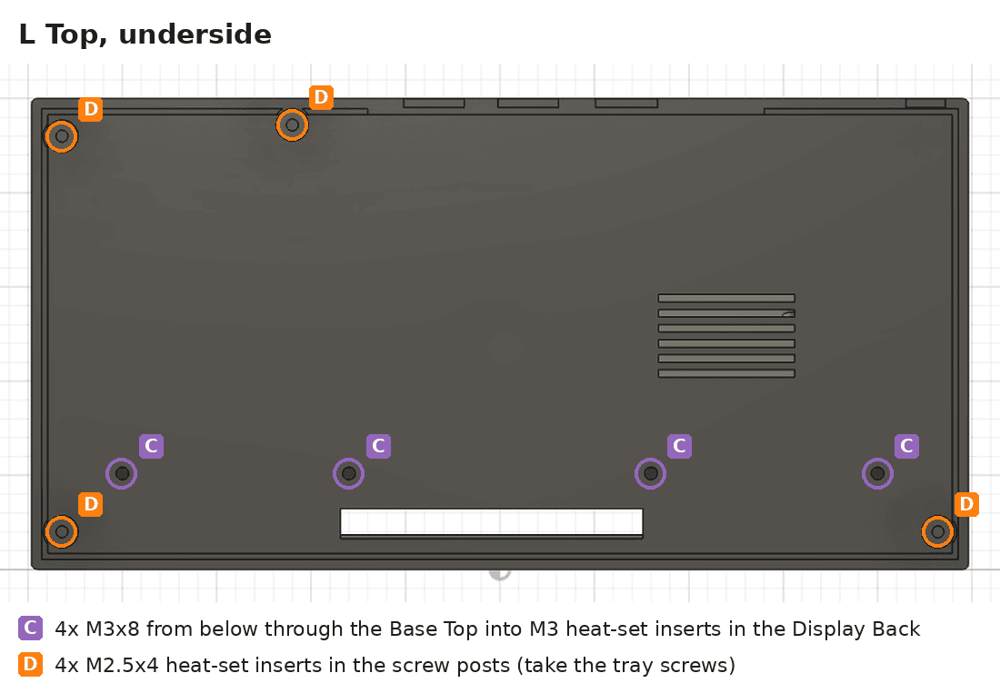
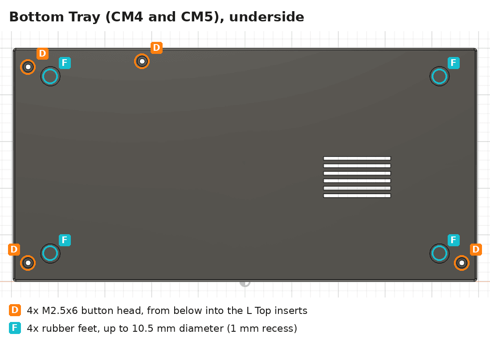

# BuzzerBox Compact case

The case of the BuzzerBox Compact: a lightweight box with the touchscreen built in, on which the host can run the game
(the game master) without a phone or tablet. The teams' screen is a TV or projector on its HDMI port.

The case has two parts: the **bottom tray**, which holds the Raspberry Pi Compute Module on its IO board, and the
**top** (*L Top* in the Fusion file and the pictures), which closes the tray and holds the touchscreen. The top is
printed in two pieces: the **plate** (*Base Top*), which closes the tray, and the tilted **back of the display**
(*Display Back*) on top of it, screwed together from inside the box.

| Part | Files | Size (W × D × H) |
|---|---|---|
| Bottom tray, Compute Module 4 | `buzzerbox-compact-bottom-tray-cm4.{step,3mf,stl}` | 248 × 125 × 25 mm |
| Bottom tray, Compute Module 5 | `buzzerbox-compact-bottom-tray-cm5.{step,3mf,stl}` | 248 × 125 × 25 mm |
| Top, both pieces | `buzzerbox-compact-top.{step,3mf}` | |
| Top: plate | `buzzerbox-compact-top-plate.stl` | 248 × 125 × 25 mm |
| Top: back of the display | `buzzerbox-compact-top-display-back.stl` | 248 × 72 × 157 mm |

Print one bottom tray, for the Compute Module the box has, and both pieces of the top. The top's 3MF holds both
pieces as separate objects; the STL files have one piece each, for slicers without 3MF.

`buzzerbox-compact-case.f3d` is the Fusion source of the top and both trays.

## Parts

| Part | Count | Where (letters as in the pictures below) |
|---|---|---|
| Raspberry Pi Compute Module 4 or 5, 4 GB RAM | 1 | On the IO board; print the bottom tray for it |
| The Compute Module's IO board (CM4 IO Board or CM5 IO Board) | 1 | On four standoffs in the tray (E) |
| Raspberry Pi Touch Display 2, 10 inch | 1 | In the back of the display (A, B) |
| M2.5 × 4 heat-set inserts | 8 | 4 in the tray's standoffs (E), 4 in the top's screw posts (D) |
| M3 heat-set inserts | 4 | In the underside of the back of the display (C) |
| M2.5 × 6 screws | 8 | 4 through the IO board (E), 4 into the display's Pi-mount standoffs (B) |
| M2.5 × 6 button head screws | 4 | From below through the tray into the top (D) |
| M2.5 × 8 screws | 2 | Into the display's mounting threads, head in the counterbore (A) |
| M3 × 8 screws | 4 | From below through the plate into the back of the display (C) |
| Rubber feet, up to Ø10.5 mm | 4 | In the recesses under the tray (F) |

## Assembly

1. Press the heat-set inserts in: four M2.5 into the tray's standoffs (E), four M2.5 into the top's screw posts (D) and
   four M3 into the underside of the back of the display (C).
2. Screw the IO board, with the Compute Module on it, onto the tray's standoffs (E).

   

   

3. Screw the Touch Display 2 into the back of the display from outside: two M2.5 × 8 into its mounting threads (A) and
   four M2.5 × 6 into its Pi-mount standoffs (B). The two lower holes (X) stay empty.

   

4. Screw the back of the display onto the plate from below, with four M3 × 8 (C).

   

5. Put the top onto the tray and screw it on from below, with four M2.5 × 6 button head screws (D). Stick the rubber
   feet into their recesses (F).

   

## Holes

As modelled, for checking a print or adapting the design to other inserts:

| Where | Hole |
|---|---|
| M2.5 inserts (tray's standoffs, top's screw posts) | Ø3.2 mm, 5 mm deep |
| M3 inserts (underside of the back of the display) | Ø4.0 mm, 6.7 mm deep |
| M3 screws through the plate | Ø3.4 mm through the 3 mm plate |
| M2.5 screws through the tray | Ø2.9 mm, head in a Ø5.5 × 1.2 mm counterbore |
| M2.5 screws into the display's mounting threads | Ø2.8 mm, head in a Ø5.5 mm counterbore |
| M2.5 screws into the display's Pi-mount standoffs | Ø2.8 mm through the 2 mm wall |
| Rubber feet | Ø10.5 mm, 0.9 mm deep |

The IO board's standoffs are 134 × 69 mm apart in the CM4 tray and 121.5 × 69 mm in the CM5 tray.

## Printing

The longest parts are 248 mm, so they need a print bed of at least 250 mm in one direction.
